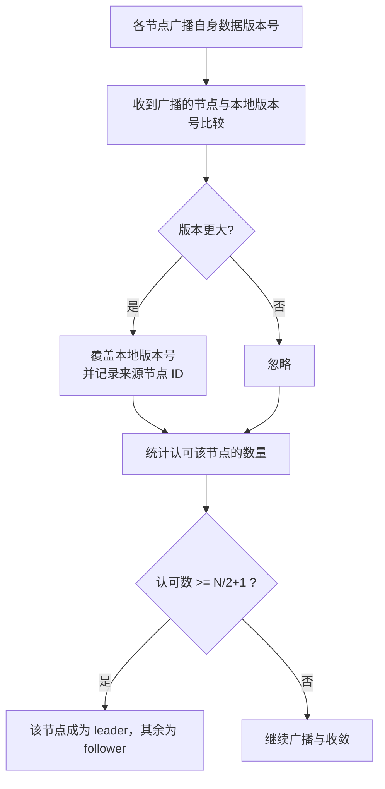
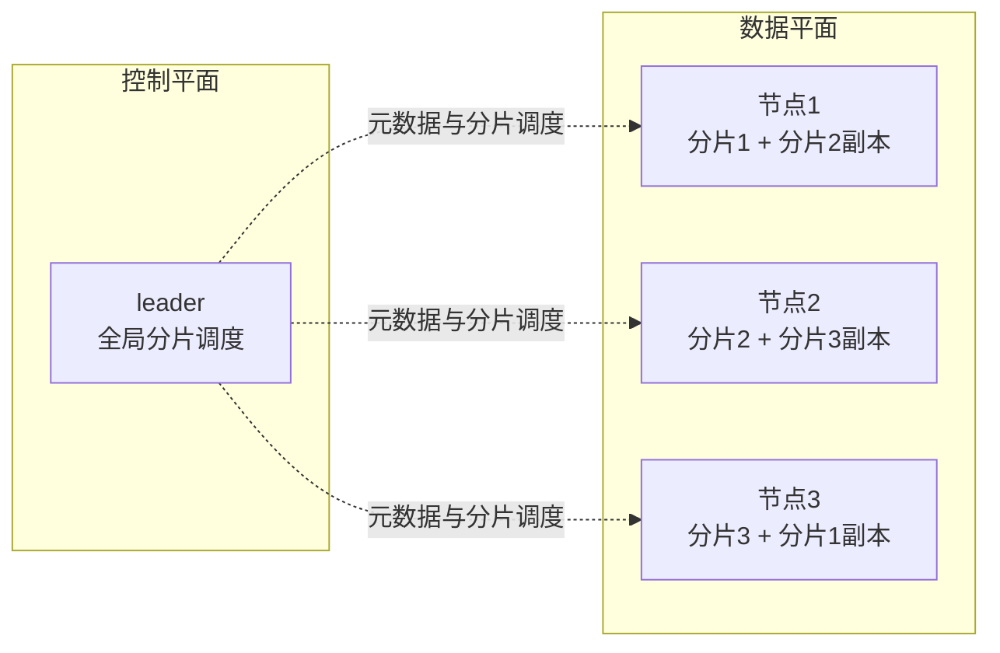
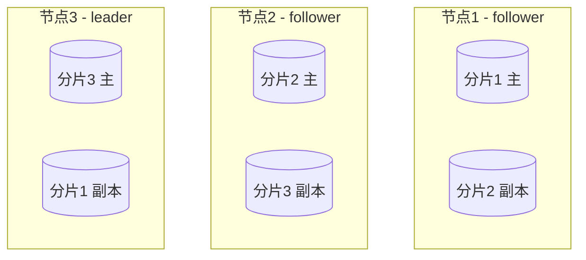
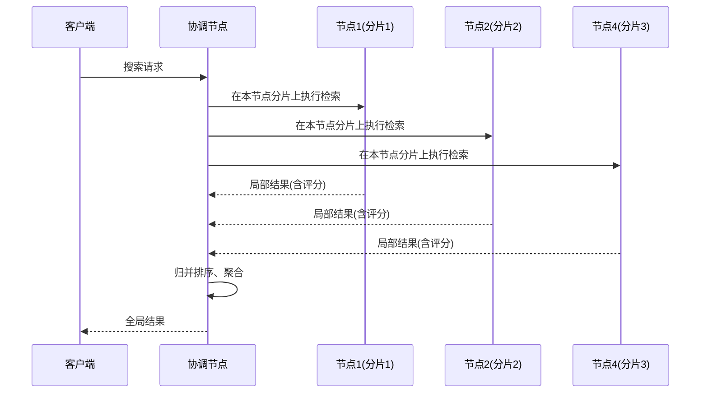

# 六大数据库存储实战: ES 分布式集群的选主、分片与副本机制

## 纲要

- Elasticsearch 集群有两层角色：**控制维度**的 leader/follower，**数据维度**的主分片/副本分片
- 选主基于类 Raft 协议，核心规则是 **N/2 + 1 多数派认可**
## 📎 代码说明

本讲代码以**内联片段**形式呈现在正文中。课程课件仅发布第 2/3/4 章（MySQL 核心能力）的完整工程源码，本讲所属章节未随课件发布独立源码文件，故不做外部文件关联，请以正文片段为准。

## 为什么存储都需要分布式方案

前面的章节用 MySQL 主从、Redis 分片解决了各自的容量与性能问题，Elasticsearch 也不例外。面对互联网场景的高并发、高流量、高数据量，单节点 ES 撑不住写入吞吐，也撑不住索引体积。

但 ES 的分布式机制和 MySQL 主从复制有本质区别，如果不先分清**控制平面**和**数据平面**，后面所有的运维现象都解释不通。

## 选主机制：控制维度的 leader

假设有五台 ES 节点。与 MySQL 在配置文件里指定"谁是 master、谁是 slave"不同，ES 的配置文件里配的是一个开关：

```yaml
# elasticsearch.yml
node.master: true     # 是否有资格参与竞选主节点，而非"我就是主节点"
node.data: true       # 是否承担数据存储
```

这个开关的语义是**参选资格**，不是身份指派。为什么要这么设计？

设想节点五的硬件较差，磁盘不是 SSD、故障率高。运维资源有限，没必要让这种节点去承担控制职责——把它配成 `node.master: false`，它就永远是一个纯数据节点（教学场景下通常五台都开放参选资格）。

### 类 Raft 的多数派选举

集群启动后，节点之间通过类 Raft 协议竞争 leader：



版本号必须满足**可比较、递增**的性质，这一点和 MySQL binlog 里的 position 非常像。举例：

- 节点一启动后广播自己的版本号 = 2，其余节点版本为 1 甚至 0（无数据）
- 节点二收到后发现 2 > 1，就把自己的版本号改为 2，并记录"最新数据来自节点一"
- 网络不可靠，可能有节点根本没收到广播，但只要**超过 N/2 + 1 的节点认可**，节点一即成为 leader

这就是集群规模取奇数的原因：

| 节点数 | 多数派门槛 | 可容忍失效节点数 |
| --- | --- | --- |
| 3 | 2 | 1 |
| 4 | 3 | 1 |
| 5 | 3 | 2 |
| 6 | 4 | 2 |

4 台和 5 台的多数派门槛都是 3，但 5 台能容忍 2 台失效，4 台只能容忍 1 台。**多出来的那台不是冗余成本，而是容错能力的台阶**。

### leader 是控制节点，不是数据节点

这是本节最容易被误解的一点。leader 的职责是**全局控制分片与副本的存储位置**，而不是把倒排索引都存到自己身上。

如果 leader 兼做唯一数据节点，那 follower 就退化成只读副本，整个架构等于 MySQL 主从，写入流量全部压在一台机器上，完全失去分布式写入的意义。



leader 自己也可以存数据——它是"既指挥又干活"，但不是"只有它干活"。

## 分片与副本

### 分片

ES 里的 index 可以理解为传统意义上的库，type 相当于表（新版本已弱化 type，一般直接用 index）。索引数据是**分片存储**的：

- 一张 1000 行的表，切成 4 个分片，每个分片约 250 行
- 逻辑上等价于把一张大表拆成多张小表
- 查询时多个分片可以**并发执行**，这是 ES 快的核心原因之一

### 副本

副本就是分片的备库。它的两个价值：

- **高可用**：主分片所在节点宕机，副本可以升主继续服务
- **读扩展**：查询可以打到副本上，分摊读压力

以"商品表 3 个分片 + 1 份副本"为例，ES 的放置策略有一条铁律：**副本分片绝不与它的主分片落在同一台物理节点上**。否则那台机器一挂，主副全丢，副本形同虚设。



ES 会动态调整放置算法来维持这条约束，运维不需要手工指定每个分片的位置。

## 一次搜索请求的完整路径

分片分散存储带来一个直接结果：**搜索天然是并行的**。



请求进入集群后，由协调节点分发到持有相关分片的节点，各节点在自己持有的分片上调用搜索引擎能力，最后把局部结果聚合归并后返回。

这里也解释了分片数量为什么不能随意设置：

| 分片策略 | 后果 |
| --- | --- |
| 分片过少 | 单分片体积过大，无法并发，扩容时无法再拆分 |
| 分片过多 | 每个分片都是完整 Lucene 实例，元数据与文件句柄开销放大，聚合成本上升 |
| 副本数为 0 | 节点宕机即部分数据不可用 |
| 副本数过多 | 写入放大（每个副本都要同步），存储成本线性上升 |

## 集群配置示例

下面给出一个三节点集群的最小可用配置与验证方式（根据讲稿逻辑补充）。

### 运行说明

```bash
# 三个节点分别配置后启动，然后验证集群状态
curl -X GET "http://localhost:9200/_cluster/health?pretty"
curl -X GET "http://localhost:9200/_cat/nodes?v"
curl -X GET "http://localhost:9200/_cat/shards/item?v"
```

### 配置说明

```yaml
# 节点一：参与竞选 + 存数据
cluster.name: social-es
node.name: es-1
node.master: true
node.data: true
discovery.seed_hosts: ["es-1", "es-2", "es-3"]
cluster.initial_master_nodes: ["es-1", "es-2", "es-3"]

# 节点三：硬件较差，仅存数据，不参与竞选
cluster.name: social-es
node.name: es-3
node.master: false
node.data: true
discovery.seed_hosts: ["es-1", "es-2", "es-3"]
cluster.initial_master_nodes: ["es-1", "es-2", "es-3"]
```

```bash
# 建索引时显式指定分片与副本
curl -X PUT "http://localhost:9200/item" -H 'Content-Type: application/json' -d '{
  "settings": {
    "number_of_shards": 3,
    "number_of_replicas": 1
  }
}'

# 观察分片分布，确认主副不在同一节点
curl -X GET "http://localhost:9200/_cat/shards/item?v"
```

### 技术点总结

- `node.master` 是竞选资格开关，不是身份指派；弱硬件节点应关掉它
- 选主走类 Raft 的多数派协议，门槛是 N/2 + 1，因此节点数取奇数
- leader 控制的是"数据放在哪"，不是"数据都放我这"
- 分片负责水平切分与并发查询，副本负责高可用与读扩展
- 副本与主分片必须跨物理节点放置
- 分片数一旦设定不可更改，建索引时必须按数据规模做预估

相关度：95%。是否需要继续：[是]。代码是否可运行：[是]。
