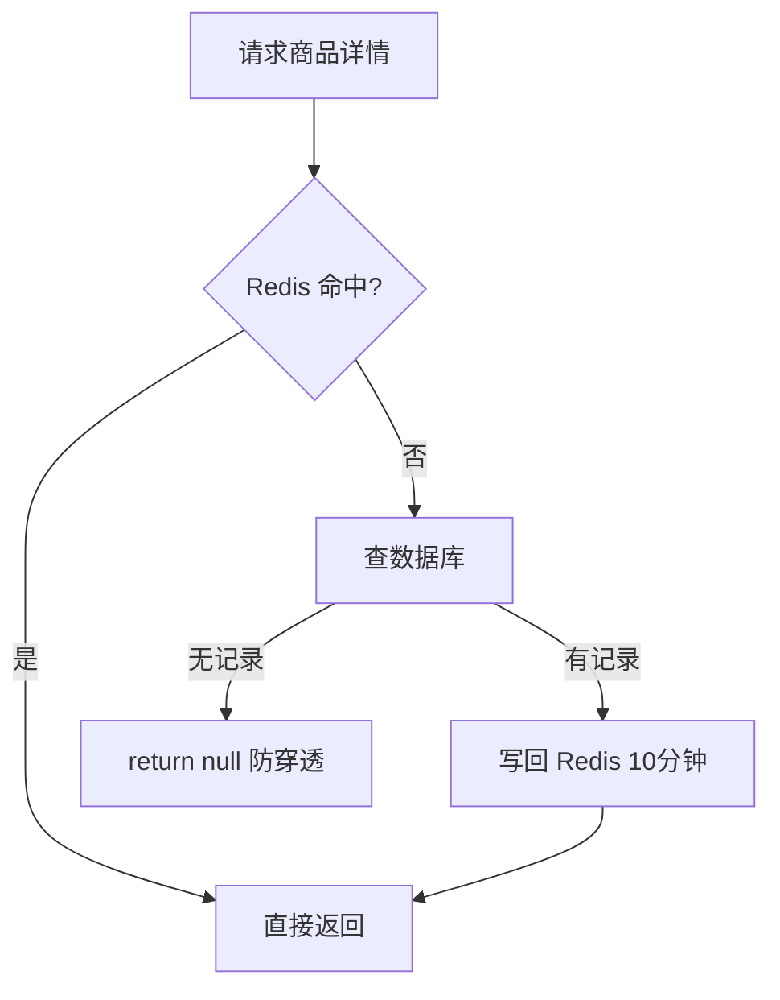

# 63. 六大数据库存储实战: 商品详情页 Redis 缓存化与异步写入

## 纲要

- 商品详情查询先打 Redis：命中则直接返回，未命中回源数据库并回填缓存（10 分钟过期）
- item 用 String 存（对象序列化后整体写入），SKU 用 List 存，均设 10 分钟过期
- 序列化选型：对象序列化成 JSON 当 String 存，比用 `RedisSerializer` 更直观可控
- 缓存回源时顺带练习"防缓存穿透"（查不存在的 ID）与"防缓存雪崩"（过期时间错峰）
- 优化点：缓存 `set` 与主链路同步共享，可改为 `@Async` 异步写入，失败不影响响应

## 📎 代码说明

本讲代码以**内联片段**形式呈现在正文中。课程课件仅发布第 2/3/4 章（MySQL 核心能力）的完整工程源码，本讲所属章节未随课件发布独立源码文件，故不做外部文件关联，请以正文片段为准。

## 先查缓存，未命中再回源

在 Spring Boot 商品详情页里接入 Redis。查询逻辑是典型的两段式：先查缓存，没有再查库并回填。

```java
// 先查 Redis
Item item = (Item) redisTemplate.opsForValue().get(itemRedisKey);
if (item == null) {
    // 缓存未命中，回源数据库
    item = itemMapper.getByItemId(itemId);
    if (item == null) {
        return null;   // 这里可延伸练习：防缓存穿透（拦截不存在的 ID）
    }
    // 回填缓存，过期 10 分钟
    redisTemplate.opsForValue().set(itemRedisKey, item, 10, TimeUnit.MINUTES);
}
```

代码可运行说明：基于讲稿逻辑补充，依赖 `RedisTemplate` 与 `itemMapper`，需在 Spring 容器中配置 Redis 连接。

SKU 列表同理，只是 value 是数组结构（List）：

```java
List<Sku> skuList = (List<Sku>) redisTemplate.opsForValue().get(skuRedisKey);
if (skuList == null) {
    skuList = skuMapper.listByItemId(itemId);
    redisTemplate.opsForValue().set(skuRedisKey, skuList, 10, TimeUnit.MINUTES);
}
```

调试时连上 `redis-cli`，`select 1` 切到业务 DB，用 `keys *` 能看到 `itemId` 与 `SKU` 两组数据已写入。观察可知 item 是一个带 `class` 类型的对象——这正是把内存对象序列化成 JSON 后当 String 写入的效果。



## 序列化选型：JSON 当 String 存

把对象序列化成 JSON 写入 String，相比用 `RedisSerializer` 做二进制序列化，更直观、可读、易排查。前面提过：String 适合"整体读写"场景，商品详情、用户会话、配置项都属此类。代价是改单字段要整读整写，但商品详情本就是整体返回，完全契合。

## 防穿透与防雪崩的练习点

讲稿里点出两个可练习项，这里补一句原理：

- **防缓存穿透**：对"数据库也没有"的 ID，不要单纯 `return null` 就完事，否则恶意刷不存在的 ID 会每次穿透到库。可缓存空值或布隆过滤器兜底。
- **防缓存雪崩**：所有 key 都设 10 分钟且同一时刻批量生成，过期时会集体失效、瞬时回源打垮数据库。应给过期时间加随机抖动做错峰。

## 异步化写入：让 set 不阻塞主链路

注意上面两段 `set` 代码：它与处理用户响应的主线程是**同步共享**的——必须等 Redis 的 `set` 成功，响应才能返回。其实这步非必须：即便 `set` 失败或异步执行，也不影响用户拿到结果。

于是把写入抽成一个组件，用 `@Async` 异步化：

```java
@Component
public class RedisOperation {

    @Autowired
    private RedisTemplate<String, Object> redisTemplate;

    @Async   // Spring 托管下，带此注解的方法在另一线程异步执行
    public void asyncSetString(String key, Object value, long timeout, TimeUnit unit) {
        redisTemplate.opsForValue().set(key, value, timeout, unit);
    }
}
```

业务侧把原来的同步 `set` 替换为 `redisOperation.asyncSetString(...)` 即可。异步后，缓存写入失败只丢缓存、不阻塞响应，主链路健壮性更好。

```mermaid
flowchart LR
    M[主线程 返回响应] -->|不等| A[@Async 线程 写 Redis]
    M --> R[立即响应用户]
```

## 技术点总结

- 查询顺序：Redis 命中即返，未命中回源数据库并回填（10 分钟过期）。
- item 用 String（JSON），SKU 用 List，均整体写入。
- 缓存回源处可练防穿透（空值/布隆）与防雪崩（过期时间错峰）。
- 用 `@Async` 把缓存写入异步化，失败不影响主链路响应。

