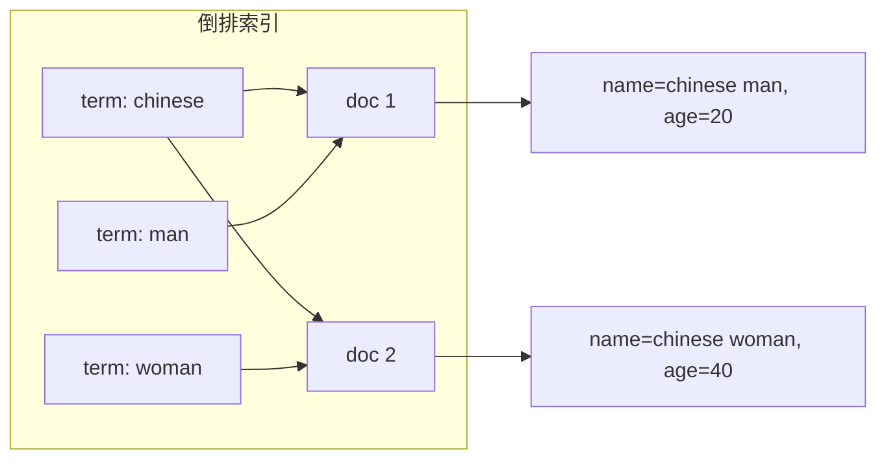
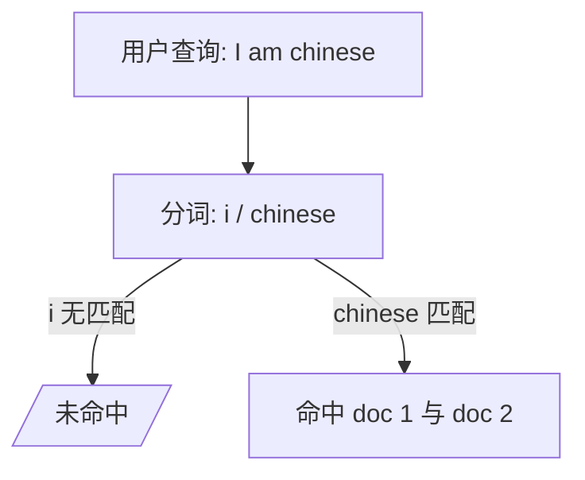

# 69. 六大数据库存储实战: 倒排索引为什么让全文搜索比 like 强

## 纲要

- Elasticsearch 强大的根本是**倒排索引（Inverted Index）**
- 分词（token）是倒排索引的基本单元：把文本切成"一串有意义的字符串"
- 英文分词器会去除无意义量词（a/an）、做词干提取（apple/apples → appl），提升召回
- 倒排索引结构：分词 term 指向一个或多个文档 ID 列表；查询时对关键词分词，拿 token 去匹配，命中的文档全返回
- 与正排索引对比：正排是"文档 → 字段"，倒排是"词 → 文档列表"，这正是全文搜索高效的原因
- ES 不止能做全文搜索：对字段建**不分词**的 term 索引，也能直接做等值匹配，具备宽表搜索能力

## 📎 代码说明

本讲为**原理 / 架构 / 选型**篇，正文以图示与推演为主，无配套代码片段，课程课件亦未提供本章源码文件。

## 分词：倒排索引的基本单元

要理解倒排索引，先理解分词。分词的定义是：**用固定的分词手段，获得一串有意义的字符串**。"有意义"是关键——不同分词器按语义切出有意义的 token，无意义的词（量词、标点）被归一化掉。

例如英文 `I have an apple`：

- 空格分词器切出 `I` / `have` / `an` / `apple`
- 但 `an` 是量词、没有检索语义；若把它建进索引，用户搜 `an` 会命中大量无效文本
- 英文分词器还会做**词干提取（stemming）**：`apple` 和 `apples` 都是"苹果"，单数复数不该建两份索引，于是统一提取为词干 `appl`

最终有效的 token 流是 `[i] [have] [appl]`。这就是为什么 ES 的全文搜索比 MySQL 的 `like` 高级：`like` 只能做子串匹配，而 ES 的分词屏蔽了量词、归一了单复数，搜索结果更准、召回更全。

## 正排索引 vs 倒排索引

假设有一张 MySQL 用户表：

| ID | name | age |
| --- | --- | --- |
| 1 | chinese man | 20 |
| 2 | chinese woman | 40 |

**正排索引**是"文档 → 字段"的结构：给定文档 ID，能取出它的 name、age。但反过来，"哪个文档包含 chinese 这个词"正排答不上来，只能逐行扫描。

**倒排索引**把顺序反过来：先分词，再让每个 term 指向包含它的文档 ID 列表。

`chinese man` 分词得到 `chinese` / `man`；`chinese woman` 分词得到 `chinese` / `woman`。于是倒排索引长这样：



所谓"倒排"，就是**倒过来排布**——从"词"反查"文档列表"。

## 查询时如何命中多文档

用户搜 `I am chinese`，这句话也先分词为 `i` / `chinese`：

- `i` 在索引里找不到
- `chinese` 关联到 doc 1 和 doc 2

于是 doc 1 和 doc 2 同时被命中返回。搜 `woman`（词干归一后仍 `woman`）则只命中 doc 2。



这正是倒排索引的价值：一次查询，用 term 指针直接定位所有相关文档，无需全表扫描。

## ES 不止全文搜索：不分词的 term 索引

虽然 ES 主打全文搜索（对 `name` 这类字段分词建索引），但它也能对字段建**不分词**的 term 索引。

例如 `age` 字段，建不分词索引后，term 就是字段本身：`20 → doc 1`，`40 → doc 2`。查询时直接用 term 等值匹配就能命中，不需要经过分词。

```mermaid
flowchart LR
    subgraph age 字段的倒排（不分词）
        A1["20"] --> D1[doc 1]
        A2["40"] --> D2[doc 2]
    end
```

这意味着：只要字段按 term 方式建了索引，即使不做全文搜索，也能被直接检索。这正是 Elasticsearch 能充当**宽表搜索引擎**的关键——既能全文搜 `name`，也能等值搜 `age` 这类结构化字段。

## 技术点总结

- 分词产出有意义的 token，是倒排索引的基本单元；英文分词去量词、做词干提取（apple→appl）
- 正排是"文档→字段"，倒排是"词→文档列表"，倒排让全文搜索免全表扫描
- 查询时对关键词分词，用 term 指针直接命中所有相关文档
- 对字段建不分词 term 索引也能等值检索，ES 因此兼具宽表搜索能力

