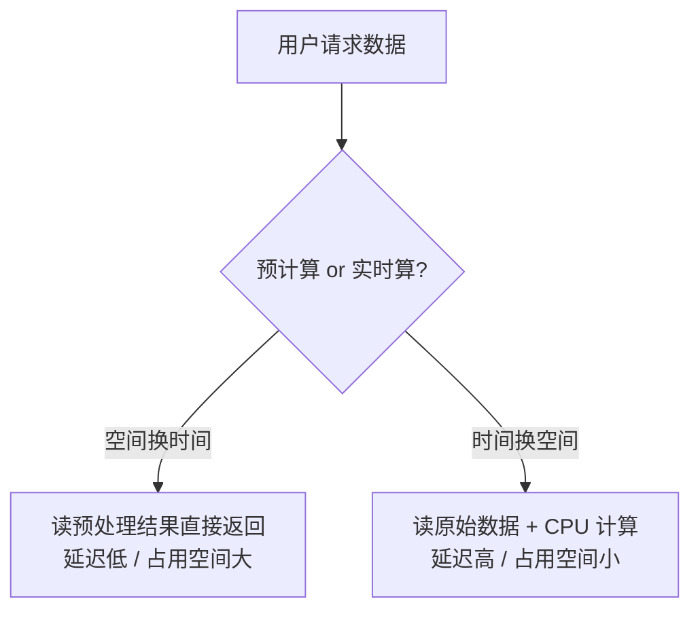

# 6. 六大数据库存储实战: 三个维度的取舍为什么让"万能方案"不存在

## 纲要

- 算力的取舍：空间换时间 vs 时间换空间
- 一致性的取舍：CAP 与 BASE 下的强一致与最终一致
- 管理模式的取舍：中心化 vs 去中心化
- 三个取舍投射到存储选型上的结论：只有最适合业务场景的方案

## 📎 代码说明

本讲为**原理 / 架构 / 选型**篇，正文以图示与推演为主，无配套代码片段，课程课件亦未提供本章源码文件。

## 算力的取舍：用空间换时间，还是用时间换空间

互联网系统中的第一类取舍发生在算力维度。假设用户上线后需要查询一大批数据，通常有两套截然不同的方案。

**方案一：用空间换时间（预计算）**

把用户的基本信息、社交属性、以及各类聚合信息**提前算好**，写进存储空间。用户登录上来查询时，直接从存储里取值返回，全程不需要 CPU 做额外计算，响应速度最快。

代价是要占用大量磁盘空间——你必须为每一个可能登录的用户（甚至全部用户）都把结果算好存着。在用户量不大时磁盘成本可以忽略，但当用户量和流量增长到一定规模，这部分成本就必须纳入考虑。

**方案二：用时间换空间（实时计算）**

只存储一份通用的原始数据，等用户真正需要时，再把数据读进内存，经过一部分计算加工后返回给用户。用户请求需要额外等待一段 CPU 运算时间。

代价是延迟上升，收益是存储空间大幅下降。

两种方案没有优劣之分，只有适配的区别。做决策时必须结合业务实际：用户对这次请求的**延迟容忍量级**是多少？数据的**空间量级**是多少？对应的**成本预算**又是多少？三个量级摆出来，答案通常是明确的。

## 一致性的取舍：强一致与最终一致

第二类取舍发生在数据一致性维度，这也是分布式系统设计中最核心的话题之一。

在分布式应用中经常提到的两个理论：

- **CAP 理论**：一致性（Consistency）、可用性（Availability）、分区容错性（Partition tolerance）三者不可兼得。当网络分区发生时，只能在一致性和可用性之间二选一。
- **BASE 理论**：基本可用（Basically Available）、软状态（Soft state）、最终一致性（Eventually consistent）。它不追求强一致，而是允许数据存在中间状态，只要最终收敛到一致即可。

落到实际业务里，取舍表现为：

| 一致性级别 | 取舍内容 | 典型场景 |
| --- | --- | --- |
| 强一致 | 牺牲部分可用性，写后必须能读到最新值 | 交易扣款、库存扣减 |
| 最终一致 | 牺牲瞬时一致性，换取高可用与低延迟 | 社交动态、点赞计数、Feed 流 |

一个最常见的具体例子是 MySQL 的读写分离：一条数据 `insert` 到主库之后，立刻从从库 `select` 可能读不到——因为主从同步存在延迟。这就是一类需要在业务层通过方案设计去规避或容忍的一致性问题。

## 管理模式的取舍：中心化 vs 去中心化

第三类取舍发生在系统的组织形态上。

**中心化管理**是绝大多数互联网应用的选择：数据集中存放在统一的存储机房里，由中心节点统一调度。它的优势是性能好、效率高、容易治理；对应的需求是两地三中心、多机房部署容灾这类策略来补足可用性。

**去中心化**是另一种思路，区块链就是典型代表。它没有一个统一的中心节点，数据在所有节点间分布式维护。优势是抗单点故障能力强，劣势则是整体性能和效率完全无法与中心化架构相比。

一旦引入去中心化设计，就必须直面数据同步延迟的问题，并用相应的业务方案去屏蔽不同机房、不同节点之间的异构细节，最终对外呈现统一的服务能力。这些都是在效率与容灾之间做的取舍。

## 取舍投射到存储选型上

把上面三类取舍投射到具体的存储产品上，结论非常一致：

无论是关系型数据库 MySQL、缓存 Redis、搜索型 Elasticsearch、图数据库 Neo4j、列式非关系型数据库 HBase，还是文档型非关系型数据库 MongoDB，**每一种存储都有它各自适合的场景，以及它自身的优劣势**。

而这些适用场景与优劣势，恰恰决定了它在某个具体业务场景中的选型结果。举个直观的例子：

- Redis 用内存换取极致读写性能，主动放弃了强持久化能力；
- HBase 用列式存储换取海量数据与列聚合效率，放弃了复杂条件查询能力；
- Elasticsearch 用倒排索引换取全文搜索能力，换取了较高的写入延迟与资源消耗；
- MongoDB 用灵活的文档模型换取复杂条件查询与高写入量，放弃了 `join` 能力；
- Neo4j 用图模型换取极强的图遍历能力，退出了非图查询的赛场。

每一种数据库都是"在某个维度上做到极致、在另一个维度上主动认输"的产物。理解它们各自"认输在哪"，比记住它们"强在哪"更重要。

## 小结

所谓"互联网没有万能的解决方案"，落实到工程上就是三个绕不过去的取舍问题：**算力的取舍、一致性的取舍、管理模式的取舍**。推演到存储选型上，结论是同样一句话——没有万能的解决方案，只有最适合当前业务场景和性能要求的数据库存储解决方案。

