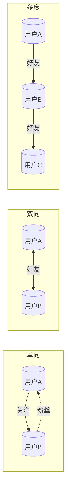
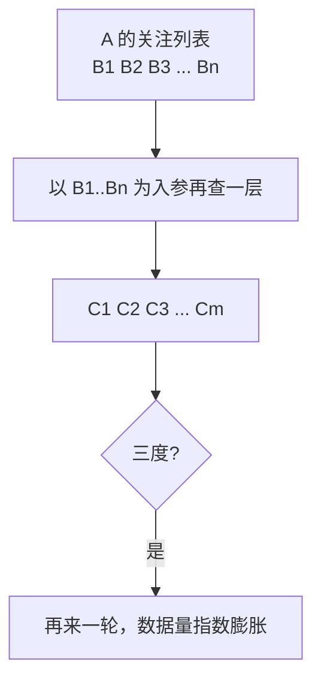
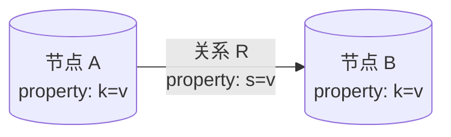
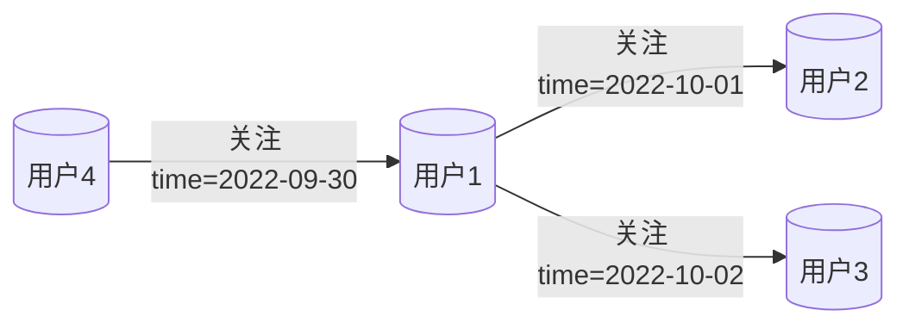

# 六大数据库存储实战: 为什么社交关系必须用图数据库来存

## 纲要

- 社交场景的三种典型关系形态：单向关注/粉丝、双向好友、多度人脉下钻
- 关系型数据库建模图关系的两大弊病
    - 边语义靠字段约定表达，扩展冗余信息要不断加列
    - 多度关系下钻需要多次 SQL + 子查询，数据量指数膨胀且只能 case by case 定制
- 图数据库的两种元素：节点（Node）与关系（Relation），二者都可以挂属性（Property）
- 关系的方向性：单向、双向、无向，区别在于边上是否需要分别表达两个方向的属性
- 图的查询视角：从节点的出度/入度遍历边，边上和节点上的属性都可参与过滤与排序

## 社交新零售里的图关系场景

前面的章节用 MySQL、Redis、Elasticsearch 支撑了门店、商品、交易、搜索等核心能力。接下来进入社交关系模块——这一块的存储形态和前面完全不同。

社交场景里有三类典型关系：



- **单向关系**：微博式的关注/粉丝。A 关注 B，反向产生 B 的粉丝 A，两个方向语义不同
- **双向关系**：微信式的好友。必须双方确认才成立，是一条无向或双向的边
- **多度关系**：二度人脉。A 是 B 的好友，B 是 C 的好友，则 A 是 C 的二度人脉

这三类能力都属于图数据库的典型应用场景。

## 用关系型数据库建模图关系有多别扭

### 弊病一：边的语义只能靠字段约定

要用 MySQL 表达 A 关注 B，最自然的做法是建一张关系表：

| 字段名 | 含义 | 示例值 |
| --- | --- | --- |
| `id` | 无意义自增主键 | 1 |
| `follower_id` | 关注人 | A |
| `followed_id` | 被关注人 | B |

于是产生三个问题：

- **语义靠约定**：必须事先约定 `follower_id` 是"关注人"、`followed_id` 是"被关注人"。查 A 的关注列表，SQL 的 WHERE 条件就要固定写成 `follower_id = A`；查 A 的粉丝列表，条件换成 `followed_id = A`。同一个业务对象，两条查询维度完全不同，且这个差异只存在于应用层的约定里
- **反向关系要额外建模**：粉丝关系要么再建一张 `fans` 表，要么在原表加一个 `type` 字段（1 表示关注、2 表示粉丝）。无论哪种，表结构都在为"边的方向"买单
- **边的冗余属性难以承载**：一旦要在边上存关注时间、关注来源、是否可取消、备注等信息，就只能不断给这张表加列。字段越加越多，表逐渐变成一张"什么都有的宽表"，而它本质上只是图里的一条边

更关键的一点：查出来的结果只有 ID。要展示用户的昵称、头像，还得拿这批 ID 回用户表再查一次，或者干脆在关系表里冗余存储用户信息——冗余一旦引入，就要维护一致性。

### 弊病二：多度关系下钻几乎无法承受

再看二度人脉：查 A 的二度关注，一条 SQL 搞不定，必须拆成两步：

```sql
-- 第一步：查出 A 关注的所有人
SELECT followed_id FROM follow WHERE follower_id = 'A';
-- 第二步：把上一步结果作为入参，再查一层
SELECT followed_id FROM follow WHERE follower_id IN (...);
```



问题在于：

- 中间结果集可能非常大，第二层查询的 `IN` 列表会膨胀到难以执行
- 层数越深，SQL 层数越多，且每一层都是**case by case 定制**的，没有通用解法
- 即便数据量可控、可以用分片或并发查询缓解，一旦关系变复杂——深度遍历、广度遍历、查找某条边的属性——用 SQL 表达都会极其笨重

关系型数据库不是不能做，而是做得非常重。图数据结构天然需要深度/广度遍历能力，这正是图数据库应运而生的原因。

## 图数据库的结构：节点、关系、属性

图数据库的结构非常直白：**图有什么元素，数据库就有什么元素**。



只有两种元素类型：

| 元素 | 说明 | 可否挂属性 |
| --- | --- | --- |
| Node（节点） | 图中的实体，如用户 | 可以 |
| Relation（关系） | 节点之间的边，如关注 | 可以 |

这带来几个直接的查询能力：

- 从 A 的**出度**方向遍历，拿到"关注了谁"
- 从 A 的**入度**方向遍历，拿到"谁关注了我"
- 边上的属性可以参与过滤与排序：查"2022 年 10 月之后建立的关系"、"按关注时间倒序返回"
- 节点上的属性同样可以过滤：查"昵称包含 X 的粉丝"



同一张图，换个遍历方向就是完全不同的业务语义，而数据在物理上只存了一份。这正是关系型数据库做不到的部分。

## 图数据库不适合什么

选型必须同时看清适用与不适用。图数据库的短板同样明显：

| 场景 | 是否适合 | 原因 |
| --- | --- | --- |
| 关注/粉丝、好友关系 | 适合 | 典型的点边遍历 |
| 多度人脉、关系推荐 | 适合 | 深度遍历是强项 |
| 权限继承、组织架构 | 适合 | 层级关系天然是图 |
| 大批量写吞吐 | 不适合 | 写操作难以分片，后文集群章节详述 |
| 简单 KV 查询 | 不适合 | Redis 更合适 |
| 聚合统计、报表 | 不适合 | 关系型数据库的强项 |
| 全文检索 | 不适合 | Elasticsearch 更合适 |

一个非常重要的工程原则：**用户的主信息仍然存放在 MySQL**，图数据库里只存关系和用户 ID。图关系库只跟 ID 打交道，昵称、头像等展示信息回主库查询。这样既能发挥图的遍历优势，又不会让图库承担它不擅长的宽表存储。

## 本章小结与后续路线

本章的推进路线：


学习方法上有一个固定套路：**先把存储本身搞透，用存储自带的 GUI 把最基本的 CRUD 练熟，结合业务诉求设计流程，最后才接入 Java API**。如果一上来就写 Java 代码，对存储的基础能力没有认知，很容易把自己绕晕。

相关度：96%。是否需要继续：[是]。代码是否可运行：[否]。
