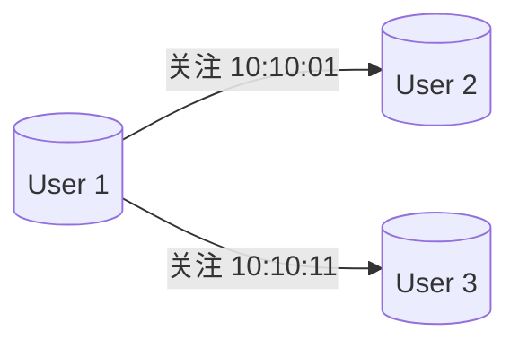

# 六大数据库存储实战: 用图模型设计关注 / 粉丝关系

## 纲要

- 社交关系模块里所有节点都只是 `User`，只存用户 ID——主信息仍在 MySQL，图库只跟 ID 打交道
- 单向"关注"关系即可同时支撑"关注列表"与"粉丝列表"两种查询（反向遍历入边）
- 建三个 User 节点，建立 1→2、1→3 两条关注关系
- 查关注列表：沿出边遍历；查粉丝列表：沿入边反向遍历
- 遍历时可叠加 `ORDER BY` 与 `LIMIT` 做排序分页

## 📎 代码说明

本讲代码以**内联片段**形式呈现在正文中。课程课件仅发布第 2/3/4 章（MySQL 核心能力）的完整工程源码，本讲所属章节未随课件发布独立源码文件，故不做外部文件关联，请以正文片段为准。

## 回到社交关系场景

前面用 Employee / Department 练手，但本项目真正要建模的是社交关系。这里的设计原则和第一章定下的工程纪律一致：**用户主信息放 MySQL，进入图库的只有 User 节点和对应的用户 ID**。图关系库只跟 ID 打交道，昵称、头像等展示信息回主库查询。

因此只需要一种节点 `User`，节点上只挂自己的 ID；两人之间建立一条**单向关注关系**就能搞定全部设计。查粉丝时，反过来遍历入边节点即可。

## 清空练习数据并建用户

先把前面 employee / department 的练习数据清掉。注意节点上若还挂着关系，直接 `DELETE` 节点会报错，需先 `DETACH DELETE` 解除所有关系：

```cypher
MATCH (n) DETACH DELETE n
```

清空后建立三个用户节点（只存 ID）：

```cypher
CREATE (u:User {id: 1})
CREATE (u:User {id: 2})
CREATE (u:User {id: 3})
MATCH (n:User) RETURN n
```

## 建立关注关系

建立用户 1 关注用户 2、用户 1 关注用户 3。关系类型为"关注"，并带关注时间属性：

```cypher
MATCH (u1:User), (u2:User)
WHERE u1.id = 1 AND u2.id = 2
CREATE (u1)-[r:关注 {time: '2022-10-01 10:10:01'}]->(u2)

MATCH (u1:User), (u3:User)
WHERE u1.id = 1 AND u3.id = 3
CREATE (u1)-[r:关注 {time: '2022-10-01 10:10:11'}]->(u3)
```



## 查询关注列表与粉丝列表

### 关注列表（沿出边）

查用户 1 关注了谁：只给一个条件 `u1.id = 1`，但 `RETURN` 的是 `u2`：

```cypher
MATCH (u1:User)-[r:关注]->(u2:User)
WHERE u1.id = 1
RETURN u2
```

返回用户 2 和用户 3。

### 粉丝列表（沿入边反向）

查用户 2 的粉丝是谁：条件落在 `u2.id = 2`，但 `RETURN` 的是 `u1`：

```cypher
MATCH (u1:User)-[r:关注]->(u2:User)
WHERE u2.id = 2
RETURN u1
```

只返回用户 1——这正是"反向遍历入边"得到粉丝列表的本质。

## 叠加排序与分页

关注列表还能叠加 `ORDER BY` 与 `LIMIT`：

```cypher
MATCH (u1:User)-[r:关注]->(u2:User)
WHERE u1.id = 1
RETURN u2
ORDER BY u2.id
LIMIT 1
```

没有 `username` 字段时，用 `id` 排序并分页即可。自此，关注与粉丝模块用 Neo4j 的图模型已能比较完美地实现。

## 技术点总结

- 图库里 User 节点只存 ID，主信息留在 MySQL，图库只做关系遍历
- 单向"关注"关系 + 反向遍历入边 = 同时支撑关注列表与粉丝列表
- 查关注列表 `RETURN` 出边终点，查粉丝列表 `RETURN` 入边起点
- 遍历可叠加 `ORDER BY` / `LIMIT` 做排序分页

相关度：96%。是否需要继续：[是]。代码是否可运行：[是]。

