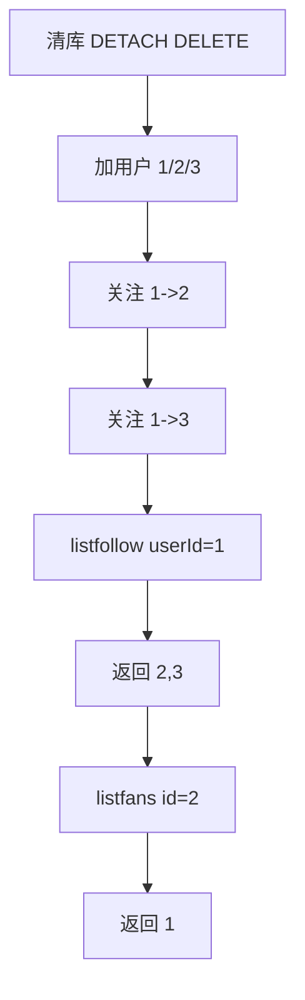

# 六大数据库存储实战: 关注 / 粉丝接口联调与常见排错

## 纲要

- 排错一：连接地址用了 GUI 的 7474 报 `HTTP is not a supported schema`，应改用 `bolt://localhost:7687`
- 排错二：建关系前必须先 `addUserNode` 落节点，否则关系写入因找不到节点报错
- 排错三：自定义 CQL 的返回值要用 `Object`（或 `Optional`），不要直接收 `Relationship`，否则报 `could not map ... relation`
- 联调顺序：先清库 → 加三个用户 → 关注 1→2、1→3 → 查关注列表、粉丝列表
- GUI 手动建的关系会与应用写入冲突，联调前用 `DETACH DELETE` 清干净

## 排错一：连接 schema 用错

应用启动时报 `HTTP is not a supported schema`。原因是 `application.properties` 里把 URI 配成了 7474（GUI 的 Web 端口）。7474 是浏览器访问的 HTTP GUI，**Java 客户端应当使用 Bolt 协议的 7687**：

```properties
# 错误
spring.neo4j.uri=http://localhost:7474
# 正确
spring.neo4j.uri=bolt://localhost:7687
```

改成 `bolt://localhost:7687` 后即可正常连接。

## 排错二：建关系前忘了建节点

在调用 follow 之前，必须先 `addUserNode` 把用户节点落进图库。如果直接调关注接口、而两端 User 节点还不存在，写入关系会因找不到对应节点报错（关系无附着对象）。

```java
// 必须先保证节点存在
userRepository.addUserNode(1L, "imooc");
userRepository.addUserNode(2L, "imooc2");
userRepository.addUserNode(3L, "imooc3");
// 再建关注关系
userRepository.addUserNodeRelation(1L, 2L);
```

`addUserNode` 入参是业务 `id` 与 `username` —— `username` 仅用于 GUI 展示，真实昵称仍以 MySQL 为准。

## 排错三：返回值类型不匹配

调用 `addUserNodeRelation` 时，如果仓库方法把返回值声明成 `Relationship`：

```java
// 错误声明
@Query("MATCH ... CREATE (u1)-[:关注]->(u2) RETURN ...")
Relationship addUserNodeRelation(...);
```

会抛出 `could not ... map ... relation`。Neo4j 驱动对这类建边语句的返回值处理有约定：应当用 `Object`（或 `Optional`）接收，不去强类型映射 `Relationship`：

```java
// 正确声明
@Query("MATCH (u1:User),(u2:User) " +
       "WHERE u1.id=$userId AND u2.id=$followId " +
       "CREATE (u1)-[:关注]->(u2)")
Object addUserNodeRelation(@Param("userId") Long userId,
                           @Param("followId") Long followId);
```

改成 `Object` 接收后，关系创建成功，错误消失。

## 联调全流程

开始前先清库，避免 GUI 阶段手动创建的关系与程序写入冲突：

```cypher
MATCH (n) DETACH DELETE n
```

然后用 debug 方式启动应用，按以下顺序联调：



1. 调 `addUserNode`：`id=1,name=imooc`、`id=2,name=imooc2`、`id=3,name=imooc3`
2. 启动后 `MATCH (n) RETURN n` 确认三个用户都已进去
3. 调 `follow`：`userId=1, followId=2`，再 `userId=1, followId=3`
4. 调 `listfollow?userId=1`：返回用户 2、用户 3
5. 调 `listfans?id=2`：只返回用户 1

至此，Java 程序接入 Neo4j、打通关注 / 粉丝全部接口的工作全部完成。

> 提示：如果在 GUI 里手动又建了 1→2、1→3，会与程序写入产生重复关系，需用 `DETACH DELETE` 清理后只保留程序写入的一份，保证联调数据干净。

## 技术点总结

- 连接用 `bolt://localhost:7687`，GUI 的 7474 不是客户端地址
- 建关注关系前必须先落 User 节点，否则无附着对象报错
- 建边 CQL 的返回值声明成 `Object`/`Optional`，不要声明成 `Relationship`
- 联调前 `DETACH DELETE` 清库，避免 GUI 手动关系与应用写入冲突

相关度：96%。是否需要继续：[是]。代码是否可运行：[是]。

