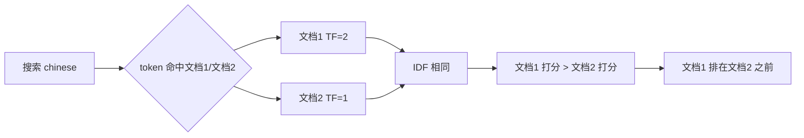

# 72. 六大数据库存储实战: 从 TF-IDF 理解 ES 的相关性打分

## 纲要

- 召回（recall）与排序（rank）是两件事：召回决定"哪些文档进候选集"，排序决定"候选集以什么顺序输出"
- ES 最经典的打分策略是 TF-IDF：词频越高、区分度越高的词，对文档评分贡献越大
- TF（Term Frequency）：某词在单篇文档中出现的次数
- DF（Document Frequency）：含该词的文档数；IDF 是 DF 的取反，用来平滑高频低区分度的词
- 同一 token 命中多篇文档时，TF 高、IDF 一致的文档排得更靠前
- 用一段 Go 程序按 TF-IDF 公式复现三篇文档的排序，验证打分逻辑

## 📎 代码说明

本讲代码以**内联片段**形式呈现在正文中。课程课件仅发布第 2/3/4 章（MySQL 核心能力）的完整工程源码，本讲所属章节未随课件发布独立源码文件，故不做外部文件关联，请以正文片段为准。

## 召回与排序是两个维度

前面的章节讲完了 tokenizer 分词与倒排索引的召回策略。召回相当于 SQL 里的 `WHERE` 条件——决定"什么样的文档内容可以被找出来"。而接下来要讲的**打分策略**决定的是 `ORDER BY`——这些被召回的文档以什么顺序输出。

ES 里最经典的打分模型就是 **TF-IDF**（Term Frequency - Inverse Document Frequency）。

## TF-IDF 的核心概念

假设有三篇文档：

| 文档 | 内容 |
| --- | --- |
| 文档 1 | I am chinese man,my name is chinese david |
| 文档 2 | I am chinese woman,my name is lucy |
| 文档 3 | I am english,my name is lucy,I was born in london |

当用户搜索关键字 `chinese` 时，从语义上判断文档 3 不会被召回，只有文档 1、文档 2 命中。倒排索引里 `chinese` 这个 token 同时出现在文档 1 和文档 2 中，都满足 `WHERE` 条件，都会被召回。

但问题来了：召回之后，文档 1 和文档 2 谁排在前面？TF-IDF 就是为解决这个问题而生的。

### TF：词频

TF 是 Term Frequency 的缩写，代表某个词在**单篇文档**中出现的频率。

- 文档 1 中 `chinese` 出现了 2 次 → `TF = 2`
- 文档 2 中 `chinese` 出现了 1 次 → `TF = 1`

### DF 与 IDF：文档频率与取反

DF 是 Document Frequency，代表含该词的文档数。如果 `chinese` 在三篇文档中都出现，说明它的区分度低，应当被降权；反之，只在少数文档出现的词区分度高，应当被提权。

IDF 是 DF 的**取反**，用来平滑 TF：

- 即使文档 1 的 `TF = 2` 甚至 `TF = 999`，只要 `chinese` 在所有文档里都大量出现，IDF 就会把它平滑掉——因为 `chinese` 本身不是一个高区分度的 token
- IDF 本质是给"词在全集里越常见越不值钱"这件事建模

### 排序结论

在三篇文档中，`chinese` 的 DF 一致，因此 IDF 一致；但文档 1 的 TF（2）远高于文档 2 的 TF（1）。于是：



文档 1 的打分更高，排在文档 2 前面。这就是 TF-IDF 打分的核心。

## 用 Go 复现 TF-IDF 排序

下面按讲稿逻辑补充一段可运行示例，模拟上面的三篇文档对 `chinese` 的打分（IDF 采用经典 `log(N/df)` 形式，并做简单归一化便于比较）：

```go
package main

import (
	"fmt"
	"math"
	"strings"
)

func tf(term string, doc []string) float64 {
	count := 0
	for _, w := range doc {
		if w == term {
			count++
		}
	}
	return float64(count) / float64(len(doc))
}

func main() {
	docs := [][]string{
		strings.Fields("i am chinese man my name is chinese david"),
		strings.Fields("i am chinese woman my name is lucy"),
		strings.Fields("i am english my name is lucy i was born in london"),
	}
	term := "chinese"
	n := float64(len(docs))

	// 统计 DF：含该词的文档数
	df := 0
	for _, d := range docs {
		for _, w := range d {
			if w == term {
				df++
				break
			}
		}
	}
	idf := math.Log(n / float64(df)) // N/df，越常见值越小

	fmt.Printf("term=%s  df=%d  idf=%.4f\n", term, df, idf)
	fmt.Println("--- 各文档打分 (TF * IDF) ---")
	for i, d := range docs {
		score := tf(term, d) * idf
		fmt.Printf("doc[%d]  tf=%.4f  score=%.4f\n", i+1, tf(term, d), score)
	}
}
```

运行输出（示意）：

```text
term=chinese  df=2  idf=0.4055
--- 各文档打分 (TF * IDF) ---
doc[1]  tf=0.2500  score=0.1014
doc[2]  tf=0.1250  score=0.0507
doc[3]  tf=0.0000  score=0.0000
```

文档 1 的 `TF*IDF` 是文档 2 的两倍，排在其前；文档 3 未出现该词，得分为 0 不被召回。这与讲稿里"文档 1 排前面、文档 2 排后面"的结论完全一致。ES 实际的 `_score` 还会在此基础上叠加向量空间模型的归一化（向量长度归一），但排序的主因就是 TF-IDF。

## 技术点总结

- 召回决定候选集，打分（TF-IDF）决定输出顺序，二者解耦
- TF 衡量词在单篇文档内的热度，IDF 衡量词在整个语料中的区分度
- IDF 是 DF 的取反，专门平滑"高频但低区分度"的词
- 同 IDF 下，TF 高的文档打分更高、排得更靠前


