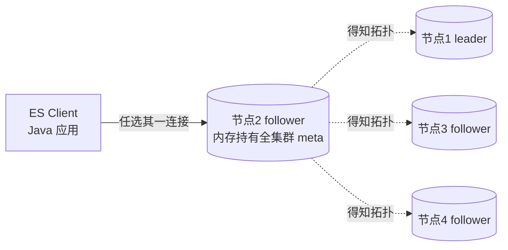
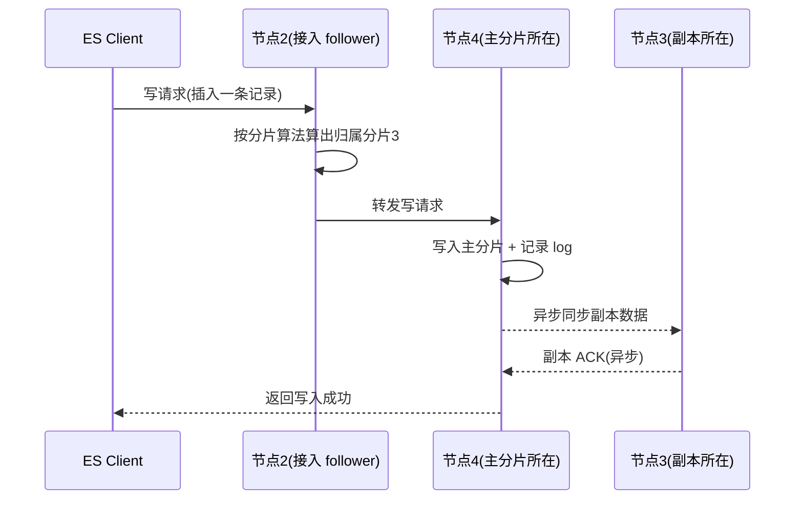
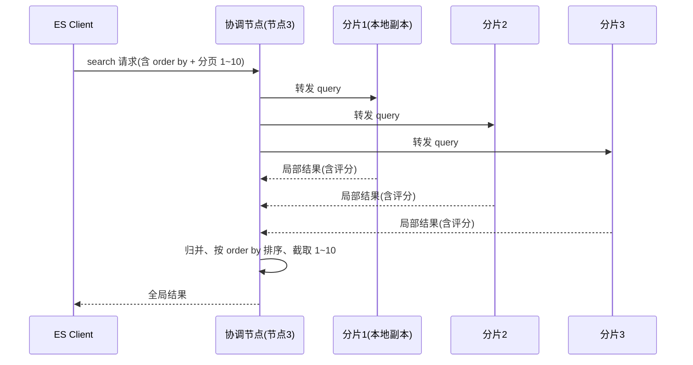
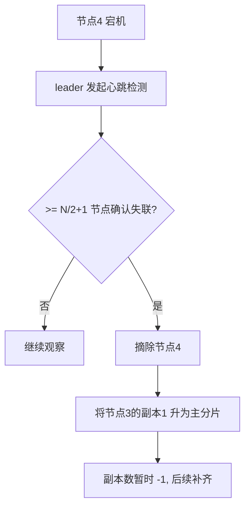

# 74. 六大数据库存储实战: ES 的读写请求全链路与故障动态迁移

## 纲要

- 客户端不需要知道集群拓扑：配置任意存活节点即可接入，目标节点内存里持有全集群的 meta 快照
- 写请求链路：接入节点按分片算法计算归属 → 转发到主分片 → 主分片落日志后异步同步副本 → 客户端即收 ACK
- 日志"同步追加、异步刷盘"：追加写无锁、成本极低，是 ES 高并发写入的底层支撑
- 读请求链路：协调节点把 query 散射到各分片并聚合、归并排序、应用分页
- 深度分页的内存陷阱：每分片都要回传 offset+size 条，用游标（scroll / search_after）把排序结果缓存在协调节点
- leader 故障检测：心跳 + 投票 + N/2+1 多数派，触发副本升主与动态分片迁移，集群容错能力随奇数节点台阶式上升

## 📎 代码说明

本讲为**原理 / 架构 / 选型**篇，正文以图示与推演为主，无配套代码片段，课程课件亦未提供本章源码文件。

## 客户端如何接入集群

和 MySQL 不同，ES 客户端不需要预先知道"谁是 leader、谁是 follower、一共有几台机器"。任意一个存活节点都可以作为接入点：

节点二（follower）启动后，内存里就已经缓存了整个集群的 meta 信息——它清楚地知道节点一是 leader、其余是 follower、每个分片落在哪台机器。这和 Redis Cluster 的设计思路一致：集群里每个分片都掌握全局快照。客户端理论上也能把这份 meta 拉回本地，但没有必要，因为接入节点会自动帮你处理好数据路由与聚合。

## 写请求链路

假设客户端要插入一条记录。数据到底落在分片一、分片二还是分片三，是由一个公开的分片算法（如取模、一致性哈希）决定的，接入节点自己就能算出来。

链路分三步：

1. 接入节点（节点二）计算出目标分片在节点四上，把写请求转发过去
2. 节点四（主分片）完成写入，并通过类 binlog 的机制把数据发给节点三（副本）
3. 副本数据同步是一个**异步**过程——客户端并不需要等副本写完才收到返回

主分片在内存里记录了 log、把数据放进内存后，就可以直接给客户端返回。ES 内部再异步地把倒排索引刷新（refresh）到磁盘。因此一条数据从写入到"能被搜索到"，通常有秒级延迟。对搜索引擎而言这个延迟完全可以接受。

### 为什么日志同步写、异步刷

这里有一个关键设计：日志文件是**同步追加**的，但**异步刷盘**。

- 如果日志丢失，数据就补偿不回来了，所以写入日志这一步必须同步
- 但"追加写"和"覆盖写"的成本完全不同：追加写通过 IO 映射（memory mapping）按顺序追加，不竞争行锁/表锁，几乎无锁，开销极小
- 这类比 MySQL：大量性能优化集中在 `SELECT/UPDATE/DELETE WHERE` 这类竞争行锁、表锁的场景，而 `INSERT` 追加写基本不需要专门优化——只要磁盘 IO、内存、CPU 跟得上，追加写本身就很快

本质是**有锁 vs 无锁**的设计差异，也是 ES 能扛住大规模并发写入的原因之一。

## 读请求链路

读请求（search）和写请求一样，由接入节点充当协调节点。协调节点依据 meta 信息把查询散射（scatter）到相关分片，再把各分片的局部结果聚合（gather）回来。

协调节点会智能地选择分片副本（就近、负载等无强逻辑），把同一句 query 原样下发给各分片。各分片返回局部结果后，协调节点在自己内存里做最终排序和分页。

### 深度分页的内存陷阱

假设查询带 `order by` 和分页，要取第 1~10 条。协调节点会把这句 query 下发给每个分片，每个分片返回自己的局部前 10 条，协调节点合并后做全局排序再截取——这没问题。

但如果是**深度分页**，例如取第 10200~10400 条：

- 每个分片都要回传 0~10400 的数据（三万多条）
- 协调节点要在内存里对全部三万多条做排序和运算
- offset 越深，内存与 CPU 消耗越大

解决办法是使用 ES 的**游标**能力（scroll / search_after）：

第一次翻页就把全部待排序数据拿到、在协调节点内存排好，之后只要传入相同的游标 ID，就只在缓存里做分段展示，不再向各分片重新转发请求。这是深度分页场景下的通用设计方案。

## leader 故障检测与动态分片迁移

讲了这么多读写，最后看 leader（控制节点）在故障时的作用。leader 平时只负责"你放这、你放那"——安排分片和副本的位置。它并非闲职：

- 所有节点与 leader 保持心跳
- 某节点（如节点四）宕机，由 leader 发起投票：当 `N/2+1` 个节点确认它挂了，该节点被摘除
- leader 知道节点四的分片一数据在节点三有副本，于是把节点三的副本**升级为主分片**，同时少了一份副本
- 整个控制与数据迁移完全由 leader 主导触发

读写请求可以连在任意存活节点上，由该节点负责写转发与读聚合。容错能力由多数派门槛决定：

| 节点数 | 多数派门槛(N/2+1) | 可容忍失效 |
| --- | --- | --- |
| 3 | 2 | 1 |
| 4 | 3 | 1 |
| 5 | 3 | 2 |
| 6 | 4 | 2 |

如果 5 台挂了 1 台剩 4 台，仍满足多数派，可继续工作；再挂 1 台剩 3 台，到极限；再挂 1 台不足 3 台（低于多数派门槛），整个集群停止工作——这就是 Raft 协议的基本要求。

