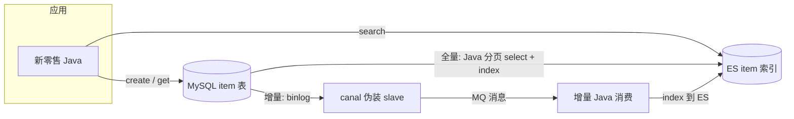
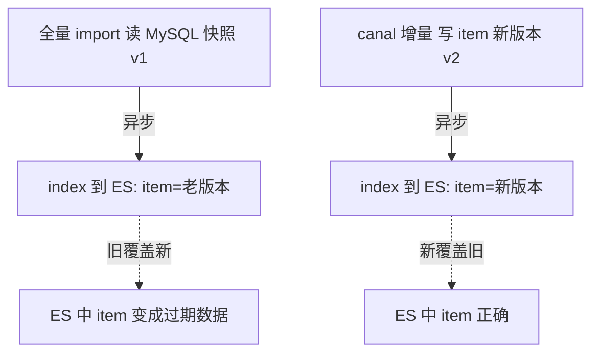
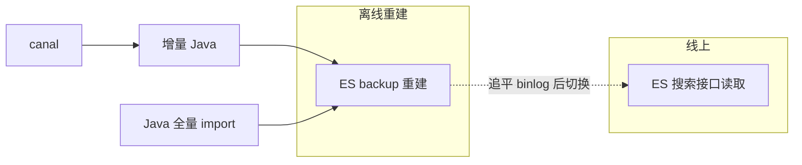

# 76. 六大数据库存储实战: 全量与增量索引的双写架构及版本冲突治理

## 纲要

- 把商品搜索能力从 MySQL 迁到 ES，本质是**数据异构**：迁移后应用对 MySQL 只保留 `create`/`get`，把 `search` 切到 ES
- 索引构建分两条线：**全量**用 Java 程序分页 `select` 后批量 `index`；**增量**用 canal 伪装成 MySQL slave，订阅 binlog 推送给 Java 消费端
- 两条线并发的最大陷阱：全量快照读入的数据，可能用旧版本覆盖 canal 增量写入的新版本
- 解法一（防覆盖）：给 item 加 `version` 字段，写入 ES 时做乐观锁比对，新版本绝不许被历史版本覆盖
- 解法二（平滑切换）：用第二份 ES（ES backup）重建索引，追平 binlog 后再切搜索接口，不在线上存储上来回切换
- 上线分两种：第一次上线（停 canal 消费→全量导入→追平→切 ES）与第 N 次上线（在 ES backup 集群上同样操作，线上不动）

## 📎 代码说明

本讲为**原理 / 架构 / 选型**篇，正文以图示与推演为主，无配套代码片段，课程课件亦未提供本章源码文件。

## 什么是数据异构

新零售场景原本所有商品的 `create`/`get`/`search` 都在 MySQL。现在要把搜索能力切到 ES，这意味着应用对 MySQL 只保留 `create` 和 `get`，把 `search` 移走。于是需要一套方案把 MySQL 的商品表"镜像"到 ES。

这张商品表映射到 ES，靠两套机制保证：

- **全量 import**：Java 程序每天去 MySQL 把全部数据 `select` 出来，灌进 ES 索引
- **增量 canal**：canal 伪装成 MySQL 的 slave，读取 binlog，把变更以消息形式推给 Java 增量消费端，再 `index` 到 ES

全量负责"基线正确"，增量负责"持续保鲜"，二者必须配合。

## 全量与增量的执行节奏

- 全量执行通常是 **T+1**：每天零点后跑一次，构建昨天全量商品数据
- 增量是**准实时**：零点之后的数据走 canal

但全量 Java import 可能要跑 1~2 小时甚至更久（要构建全量商品）。理论上只要 canal 做得足够好，全量只需在引入 ES 时做一次，之后全靠 canal 补——这确实更优。但产线上 canal 会丢数据、脚本会失效、准实时管道也难以处理"洗历史数据再入 ES"这类重活，所以全量批处理仍不可或缺。

## 核心难题：全量与增量并发的版本冲突

全量与增量是两条**异步**线，时序无法控制，直接落 ES 会出大问题。

设想：全量 import 正在读 MySQL 快照，同时商家通过 `create` 发了新品，canal 也跑了一遍把新品推到 ES。最可怕的不是"数据跑了两遍"，而是**全量快照读到的旧版本，覆盖了 canal 写入的新版本**——流入 ES 的数据变得不稳定。

两条线谁先到 ES 不确定，旧覆盖新就造成数据回退。

### 解法一：item version 乐观锁

给 item 加一个 `version` 字段（版本号/时间戳）进入 ES。对 item 的任何写入，永远先做一次乐观锁比对：只有待写入版本更新，才允许覆盖。

这样无论增量 Java 消费到的是 canal 的新数据还是旧数据，只要在最后 `index` 到 ES 这一步做好 version 比对，就不会出现新版本被历史版本覆盖。

### 解法二：双 ES 平滑切换

仅靠 version 还不够——首次上线和后续上线，切换动作本身要稳。核心思路是准备**两份 ES**：线上搜索永远读 ES，增量重建在另一份 ES backup 上做，互不干扰。

## 第一次上线流程

1. 搜索接口仍读 MySQL，让 ES 暂不生效
2. **停 canal 消费**（不是停 canal 本身）：MySQL 的增量数据继续流入 canal 堆积，但 canal 不往增量 Java 推，卡住
3. 此时商家通过 `create` 发的新品，不会被全量 import 读到（全量期间应用不真正发品），保证全量与增量无重叠
4. 跑 Java 全量 import，把快照数据导进 ES
5. 重启 canal 消费：积压消息里，凡是不在全量 import 范围内的，正常 `put` 到 ES；凡是在全量范围内的、且早于全量快照版本的，靠 item version 乐观锁拦截，不覆盖
6. 等 canal 消费追上 MySQL binlog 版本后，把搜索接口切到 ES

## 第 N 次上线流程

线上 ES 不动，引入另一条 canal + Java import 管道，专门重建 **ES backup** 集群：同样停 canal 消费 → 全量 import → 重启 canal 消费 → 追平 binlog 版本 → 把搜索接口切到 ES backup。这样线上存储始终不被来回切换打扰。

## 两个关键设计点

| 设计点 | 问题 | 方案 |
| --- | --- | --- |
| 全量/增量冲突 | 旧版本覆盖新版本 | item 加 version，ES 端乐观锁比对，新不覆盖旧 |
| ES 切换 | 线上存储来回切换风险高 | 另起一份 ES backup 重建，再切搜索接口 |

## 技术点总结

- 迁搜索到 ES 是数据异构：应用对 MySQL 只留 `create`/`get`，`search` 切到 ES
- 全量（Java 分页 import）管基线，增量（canal 订阅 binlog）管保鲜，两条异步线必须配合
- 最大陷阱是旧版本覆盖新版本；用 item version 乐观锁在 ES 写入端拦截
- 用第二份 ES backup 做离线重建，追平 binlog 后再切搜索接口，避免线上存储抖动
- 首次上线与第 N 次上线流程一致，区别仅在是否动线上 ES

