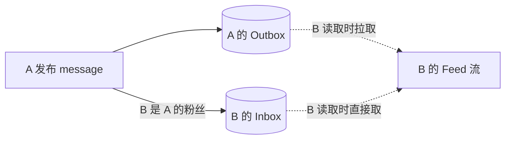
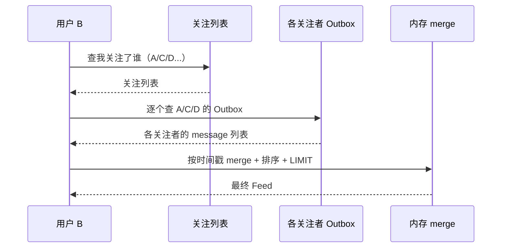
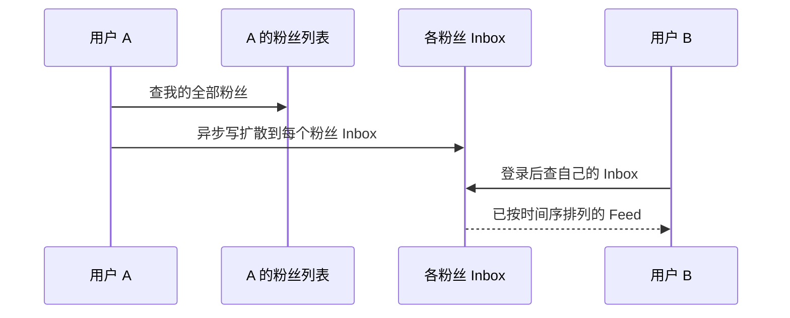

# 六大数据库存储实战: Feed 流的经典推拉设计模式

## 纲要

- 两个核心容器：发件箱（Outbox，按发布者维度）与收件箱（Inbox，按接收者维度），二者都只存 messageID
- 拉模式：读取时查关注列表 + 查各关注者发件箱，再 merge 排序，本质是"读扩散"
- 推模式：发布时把消息写进所有粉丝收件箱，读取只需查自己收件箱，本质是"写扩散"且可异步
- 取舍一句话：拉模式用时间换空间，推模式用空间换时间
- 推模式两大硬伤：大 V 写扩散不可承受；僵尸 / 非活跃粉丝白白占用存储
- 引出推拉混合：按"是否大 V / 是否活跃"分流，该推的推、该拉的拉

## 📎 代码说明

本讲代码以**内联片段**形式呈现在正文中。课程课件仅发布第 2/3/4 章（MySQL 核心能力）的完整工程源码，本讲所属章节未随课件发布独立源码文件，故不做外部文件关联，请以正文片段为准。

## 发件箱与收件箱

要讲推拉，先抛两个名词。设想用户 A 是用户 B 的粉丝，A 发布的消息要让 B 在首页按时间倒序看到：

- **发件箱（Outbox）**：挂在**发布者**维度，"我发过什么"。A 的每一条 message 都进 A 的 Outbox。
- **收件箱（Inbox）**：挂在**接收者**维度，"我该看到什么"。B 作为 A 的粉丝，A 的 message 要进 B 的 Inbox。



一次发布会产生两条 Feed 冗余：一条在发布者 Outbox（代表"我发了"），一条在粉丝 Inbox（代表"我关注的人发了"）。通常我们说用户视角的"Feed"，指的是从自己 Inbox 拉出来的那一份；而发布者的 Outbox 更多出现在他的个人主页。

> 关键约定：Outbox / Inbox 里**只存 messageID，不存 message 实体**。拿到 ID 后再用 RowKey 回 HBase 查 `message` 实体，速度极快。

## 拉模式：读扩散

拉模式的逻辑：B 登录后，先查自己的关注列表，再逐个去查这些关注者的 Outbox，把结果 merge 并按时间排序、分页。



它的问题显而易见：关注的人越多，下的查询越多（至少两条查询，且两次查询之间像 join 一样需要 merge）。当 B 关注了 A/C/D/E/F/G 上百家，就要把上百家 Outbox 都拉出来 merge，读放大非常严重。

## 推模式：写扩散

推模式反过来：A 发布 message 时，查出自己的全部粉丝 ID，把这条 message 写进每个粉丝的 Inbox。于是 B 登录后**只需查自己的 Inbox** 一条语句即可。



推模式的"写扩散"两步（查粉丝、写 Inbox）可以在 A 发布之后**异步化**——不需要 B 立刻看到，写延迟可接受。而 B 的读取是纯同步的单表查询，还可以直接借助 RowKey 做时间序排序。

## 取舍：时间换空间，还是空间换时间

| 模式 | 扩散方向 | 读成本 | 写成本 | 一句话 |
| --- | --- | --- | --- | --- |
| 拉模式 | 读扩散 | 高（多路查询 + merge） | 低 | 用时间换空间 |
| 推模式 | 写扩散 | 低（查自己即可） | 高（写入所有粉丝） | 用空间换时间 |

互联网是读多写少的场景，用户发消息的频率远低于读消息。所以包括微博 1.0 时代在内，很多产品都以推模式为主。

## 推模式的两大硬伤

但推模式并非银弹，它有两个绕不过去的问题：

1. **大 V 搞不定**：一个几百万粉丝的大 V 发一条消息，就要往几百万个 Inbox 写扩散。即便接受读延迟，这种写放大对磁盘和数据库的性能拖累也不可承受，历史上不少社交软件的故障就源自大 V 热点。
2. **僵尸 / 非活跃用户浪费存储**：攻击者注册一批永不拉取收件箱的僵尸号去关注大 V，这些账号的 Inbox 永远不会被读取，存储完全是浪费。

## 引出推拉混合

正因为有这两大硬伤，单纯推或单纯拉都不完美，于是引入**推拉混合**：发布时加一个分流判断——是不是大 V？是不是非活跃？

- 是普通用户 → 推模式，写进粉丝 Inbox；
- 是大 V → 不推，读取时改走拉模式去查大 V 的 Outbox；
- 最后在内存里把"自己 Inbox 的 N 条"和"大 V Outbox 拉的 N 条"merge 排序，取前 N 条。

非活跃用户的判定是动态过程（今天不活跃、明天活跃了要回放遗漏），实现较复杂，本版本先只引入"大 V 不推、改拉"这一条规则。

## 设计模式示意（根据讲稿逻辑补充）

下面用一段 Go 伪代码把"发布时如何按是否大 V 分流"讲清楚，重在表达 fan-out 思路而非真实 HBase 调用：

```go
package feed

import "context"

// Publish 发布一条消息，并按是否大 V 决定推 / 拉
func Publish(ctx context.Context, msg Message) error {
    // 1. 发件箱永远写一份（无论是否大 V）
    if err := writeOutbox(ctx, msg.PublisherID, msg); err != nil {
        return err
    }

    // 2. 查粉丝列表
    fans, err := listFans(ctx, msg.PublisherID)
    if err != nil {
        return err
    }

    // 3. 大 V：不推收件箱，留给读取时拉取；普通用户：写扩散到粉丝 Inbox
    if isBigV(msg.PublisherID) {
        return nil // 推拉混合：大 V 短路，读取侧改拉
    }
    for _, fan := range fans {
        if err := writeInbox(ctx, fan, msg); err != nil {
            return err
        }
    }
    return nil
}
```

要点：`writeOutbox` 对所有人都执行；`writeInbox` 在遇到大 V 时直接 `return`，把写放大挡在门外，代价是读取侧要对大 V 单独走拉模式。

相关度：92%。是否需要继续：[是]。代码是否可运行：[是]。
