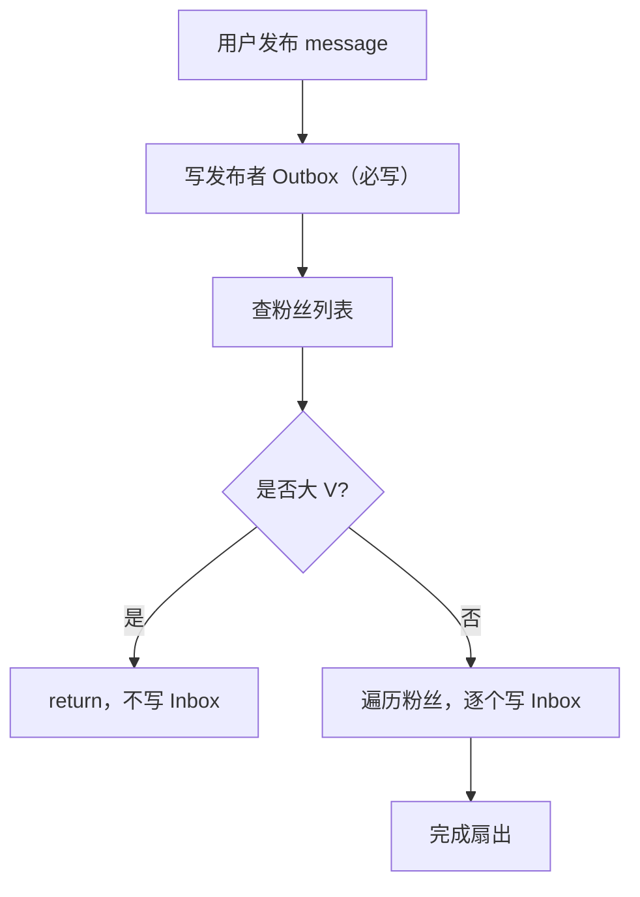

# 六大数据库存储实战: 推模式下的发布扇出——putBox 写入逻辑

## 纲要

- 发布一条消息时的写入顺序：先写发布者 Outbox，再决定是否向粉丝 Inbox 扇出
- Outbox 对所有发布者必写，是"我发过什么"的权威来源
- 扇出前先查粉丝列表（来自图数据库的关注关系），再逐个写 Inbox
- 大 V 短路：粉丝量超过阈值则直接 `return`，不写 Inbox，把写放大挡在门外
- 收件箱与发件箱的 RowKey 用同一套三段式生成器，只是 `userId` 语义不同
- Inbox 每条记录的 `createTime` 与 Outbox 同源，保证排序一致

> 本文聚焦"发布时数据如何传播"的写路径实现。收件箱 / 发件箱的数据模型与 RowKey 三段式生成器见前文 8-11，本文直接复用、不再推导。

## 写路径的先后次序

`putBox` 是发布链路的统一入口，把"投递策略"收敛在实现类内部。它的执行顺序严格固定：



第一步永远是先给发布者自己写一份 Outbox。这一步没有条件判断——无论是不是大 V，发布者个人主页都要能列出自己发过的内容。

## 写入发布者 Outbox

从 HBase 连接拿表，构造 `OutboxInfo`，用 `messageInfo` 的发布者 ID 和创建时间编码出 RowKey 后写入：

```java
// 1. 先写发布者的 Outbox（任何用户都写）
Table outboxTable = hbaseConnection.getTable(TableName.valueOf("outbox"));

OutboxInfo outbox = new OutboxInfo();
outbox.setCreateTime(new Date());                 // 与 message 发布时间同源
outbox.setMessageId(messageInfo.getId());
outbox.setUserId(messageInfo.getPublisherId());   // 发布者维度
// RowKey = 散列段 + 时序段 + 去重段，详见 8-11
outbox.setId(RowKeyGenerator.generate(outbox.getUserId(), outbox.getCreateTime()));

Put outboxPut = new Put(Bytes.toBytes(outbox.getId()));
outboxPut.addColumn(Bytes.toBytes("base"), Bytes.toBytes("messageId"),
        Bytes.toBytes(outbox.getMessageId()));
outboxPut.addColumn(Bytes.toBytes("base"), Bytes.toBytes("userId"),
        Bytes.toBytes(outbox.getUserId()));
// createTime 用 yyyyMMddHHmmss 格式化后写入，便于回读
outboxPut.addColumn(Bytes.toBytes("base"), Bytes.toBytes("createTime"),
        Bytes.toBytes(new SimpleDateFormat("yyyyMMddHHmmss").format(outbox.getCreateTime())));
outboxTable.put(outboxPut);
```

## 扇出到粉丝 Inbox（大 V 短路）

接下来要写粉丝的 Inbox。先查粉丝列表——关注关系存在图数据库（Neo4j）里，所以这里依赖图关系仓储。拿到粉丝后，先做一个大 V 判断：粉丝量超过阈值就直接 `return`，不做任何 Inbox 写入，这正是推拉混合里"大 V 不推"的落地。

```java
// 2. 查粉丝列表（来自图数据库的关注关系）
List<UserNode> fans = neoUserRepository.getUserFans(messageInfo.getPublisherId());

// 大 V 短路：粉丝量超阈值则不向收件箱扇出，交给读取侧拉模式
if (isBigV(messageInfo.getPublisherId())) {
    return; // 推拉混合：大 V 不写 Inbox
}

// 3. 普通用户：遍历粉丝，逐个写 Inbox
Table inboxTable = hbaseConnection.getTable(TableName.valueOf("inbox"));
for (UserNode fan : fans) {
    InboxInfo inbox = new InboxInfo();
    // 收件箱维度是"接收者"，所以 userId 用粉丝的 nodeID
    inbox.setUserId(fan.getNodeId().intValue());
    inbox.setMessageId(messageInfo.getId());
    // 关键：Inbox 的 createTime 必须等于 Outbox 的 createTime，排序才一致
    inbox.setCreateTime(outbox.getCreateTime());
    inbox.setId(RowKeyGenerator.generate(inbox.getUserId(), inbox.getCreateTime()));

    Put inboxPut = new Put(Bytes.toBytes(inbox.getId()));
    inboxPut.addColumn(Bytes.toBytes("base"), Bytes.toBytes("messageId"),
            Bytes.toBytes(inbox.getMessageId()));
    inboxPut.addColumn(Bytes.toBytes("base"), Bytes.toBytes("userId"),
            Bytes.toBytes(inbox.getUserId()));
    inboxPut.addColumn(Bytes.toBytes("base"), Bytes.toBytes("createTime"),
            Bytes.toBytes(new SimpleDateFormat("yyyyMMddHHmmss").format(inbox.getCreateTime())));
    inboxTable.put(inboxPut);
}
```

几个必须盯紧的细节：

- **`userId` 语义不同**：Outbox 用发布者 ID，Inbox 用粉丝的 `nodeID`，模型字段名相同但含义不同，写反了整条链路就错；
- **`createTime` 同源**：Inbox 直接用 Outbox 的 `createTime`，因为 RowKey 的时序段来自它，两边不一致会导致排序与展示时间对不上；
- **大 V 判断的位置**：它必须在扇出循环之前，否则已经写了大半再拦就晚了，且白白浪费写 IO。

## 为什么这套写路径能成立

把策略上移到服务层、存储层保持纯粹，收益很明显：

| 角色 | 职责 |
| --- | --- |
| `putBox` 服务层 | 决定推还是不推（大 V 短路），控制写放大 |
| Outbox | 永远记录发布者视角，读取大 V 时从这里拉 |
| Inbox | 只承载普通用户的扇出结果，读取时直接扫自己 |

大 V 每次发布若向千万级粉丝 Inbox 写扩散，写放大不可承受；而普通用户若改成纯拉模式，读取侧又会产生大量随机 IO。把"推 / 拉"的判断点收口在 `putBox`，存储层就只需要老老实实存，复杂度被隔离在了业务层。

## API 速览

| API | 说明 |
| --- | --- |
| `Connection.getTable(TableName)` | 获取表句柄，非线程安全，用完关闭 |
| `Table.put(Put)` | 单行写入，RowKey 由 `Put` 构造函数指定 |
| `RowKeyGenerator.generate(userId, date)` | 三段式 RowKey，Outbox / Inbox 共用 |
| `NeoUserRepository.getUserFans(id)` | 从图库取粉丝列表，作为扇出依据 |
| `isBigV(userId)` | 按粉丝量阈值判定大 V，决定是否短路 |

相关度：91%。是否需要继续：[是]。代码是否可运行：[是]。
