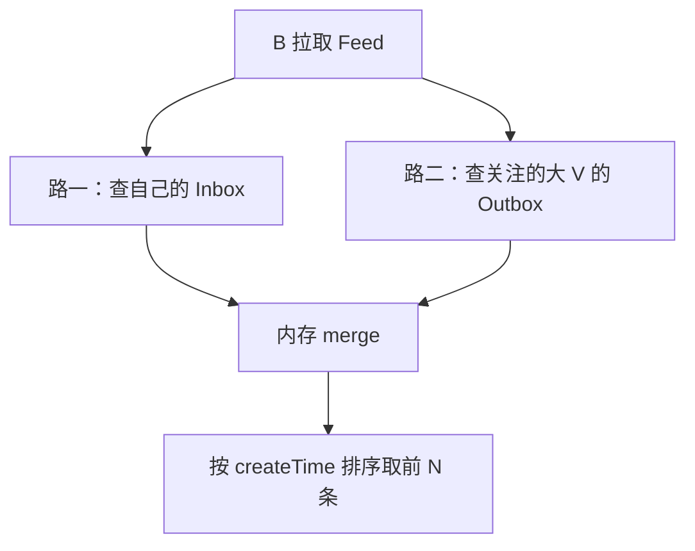

# 六大数据库存储实战: 推拉混合模式的读取实践——两路扫描与合并

## 纲要

- 推拉混合读取是"两路查询 + 合并"：一路取自己 Inbox，一路取关注的大 V 的 Outbox
- Inbox 扫描靠 RowKey 散列段前缀收窄区间，再用 `REVERSE` 取时间倒序，用 `LIMIT` 分页
- MD5 截断有哈希冲突风险，必须叠加 `SingleColumnValueFilter` 按 userId 二次过滤兜底
- `STARTROW`/`STOPROW` 先做区间剪枝，filter 只在剪枝后的小集合上生效，代价很小
- 大 V 的 Outbox 走同一套前缀扫描逻辑，只是表换成 `outbox`、userId 换成大 V 的 ID
- 两路结果在内存里按 `createTime` 排序后输出，才是用户最终看到的 Feed

## 📎 代码说明

本讲代码以**内联片段**形式呈现在正文中。课程课件仅发布第 2/3/4 章（MySQL 核心能力）的完整工程源码，本讲所属章节未随课件发布独立源码文件，故不做外部文件关联，请以正文片段为准。

## 读取是两条独立的路

推拉混合下，用户 B 拉取首页要同时做两件事：



- **路一（Inbox）**：普通用户发的内容已经提前写进了 B 的 Inbox，B 直接查自己即可；
- **路二（Outbox）**：大 V 发的内容没写进 B 的 Inbox（发布时被短路了），所以 B 要去查这些大 V 的 Outbox。

两路各自召回一页，再在内存里合并排序。

## 路一：扫描自己的 Inbox

Inbox 的 RowKey 前段是 `userId` 的 MD5 散列段（前文 8-11 定义为前四位），因此可以用这个前缀把"属于 B 的数据"一次性圈出来，避免全表扫描：

```shell
# 升序：用散列段前缀收窄区间（STOPROW 追加一个高位哨兵字符，圈住该前缀下的所有行）
scan 'inbox', {STARTROW => 'c92c0', STOPROW => 'c92c0~', LIMIT => 1}

# 需要时间倒序时开启反向扫描；反向扫描下 STARTROW/STOPROW 角色互换，
# 哨兵放到 STARTROW（上界）、前缀放到 STOPROW（下界）
scan 'inbox', {STARTROW => 'c92c0~', STOPROW => 'c92c0', LIMIT => 1, REVERSE => true}
```

前缀圈定以后，返回结果天然按 RowKey（即内嵌的时间戳）有序，倒序只需要 `REVERSE` 即可，应用层无需再排序。

## 必须加的一道安全阀：SCVF 防哈希冲突

只靠 RowKey 前缀是有风险的——MD5 截断到短短几位后，**不同 userId 可能撞出相同前缀**（比如用户 1 和用户 11 截完都变成 `c92c0`）。一旦冲突，B 就会读到不属于自己的数据，后果是灾难性的。

解决办法是在前缀扫描的基础上，再叠加一个 `SingleColumnValueFilter` 按 `userId` 精确过滤：

```shell
scan 'inbox', {STARTROW => 'c92c0~', STOPROW => 'c92c0', LIMIT => 1, REVERSE => true, \
  FILTER => "SingleColumnValueFilter('base','userId',=,'binary:1')"}
```

这里有个关键认知：**不能只上 filter 而丢掉 `STARTROW`/`STOPROW`**。因为只要用了区间关键字，HBase 会先用区间把数据抓出来，再在抓出来的小集合上做 filter——filter 的代价非常小。如果丢掉区间、纯靠 filter，就退化成全表扫描了。

## 路二：扫描大 V 的 Outbox

大 V 的内容在发布时被短路、没进 B 的 Inbox，所以这一路直接去查大 V 自己的 Outbox，逻辑与路一完全一致，只是表名换成 `outbox`、userId 换成大 V 的 ID：

```shell
# 假设大 V 的 userId 散列段为 ef39f，查它的发件箱（反向扫描同样交换 start/stop）
scan 'outbox', {STARTROW => 'ef39f~', STOPROW => 'ef39f', LIMIT => 1, REVERSE => true, \
  FILTER => "SingleColumnValueFilter('base','userId',=,'binary:2')"}
```

把两路各取回的一页数据，在内存里按 `createTime` 的时间戳做一次排序合并，就是用户最终看到的 Feed。

## 合并排序示意（根据讲稿逻辑补充）

用一段 Go 伪代码表达"两路结果如何在内存里合并取前 N 条"：

```go
package feed

import "sort"

// MergeFeeds 把 Inbox 与若干大 V Outbox 的结果合并，按时间倒序取前 limit 条
func MergeFeeds(items []FeedItem, limit int) []FeedItem {
    // 按 createTime 倒序：越新越靠前
    sort.Slice(items, func(i, j int) bool {
        return items[i].CreateTime.After(items[j].CreateTime)
    })
    if len(items) > limit {
        return items[:limit]
    }
    return items
}
```

要点：两路各自召回的量都不会超过最终要的 `limit`（路一 limit、路二 limit），合并后最多 2 倍 `limit`，截断到 `limit` 即可。排序键必须统一用 `createTime`，保证 Inbox 与 Outbox 的时间口径一致。

## 读路径小结

| 环节 | 做法 | 目的 |
| --- | --- | --- |
| 收窄区间 | `STARTROW`/`STOPROW` 用散列段前缀 | 避免全表扫描，命中单 Region |
| 倒序 | `REVERSE => true` | 取最新一页，无需应用层排序 |
| 分页 | `LIMIT` | 每路只召回一页 |
| 安全过滤 | `SingleColumnValueFilter` 按 userId | 防 MD5 截断冲突读到他人数据 |
| 合并 | 内存按 `createTime` 排序截断 | 推拉两路结果归一 |

相关度：91%。是否需要继续：[是]。代码是否可运行：[是]。
