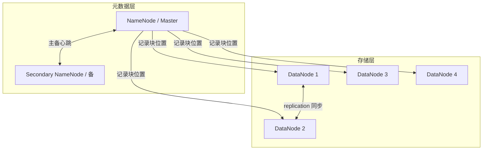
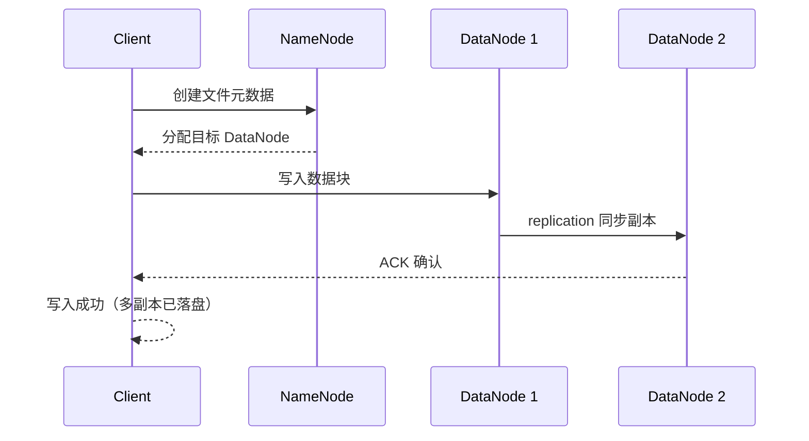

# 六大数据库存储实战: HBase 原理与优劣势——底层 HDFS 的架构支撑

## 纲要

- HBase 本身不自己管文件，数据落在 HDFS 上；理解 HDFS 才能理解 HBase 的优劣势
- HDFS 的角色：NameNode（元数据管理中心，主备）、DataNode（实际存储块）
- 文件级分片：一个大文件被打散到多个 DataNode，吞吐随节点数线性提升
- 读流程：Client 先问 NameNode 拿地址，再直连 DataNode 取数据
- 写流程：NameNode 分配目标节点，DataNode 之间走 replication 同步
- 高可用：replication 副本数可配，多数派写成功才 ACK；NameNode 主备切换兜底
- HBase 的优劣势结论：写廉价、靠 RowKey 高速读；但脱离 RowKey 即全表扫描

## HBase 站在 HDFS 的肩膀上

HBase 的"列式、高吞吐、高可用"并不是它自己实现的，而是底层依赖了 HDFS（Hadoop 分布式文件系统）。要讲清楚 HBase 的原理与优劣势，必须先看 HDFS 是怎么设计的。

一套 HDFS 至少包含两类角色：

- **NameNode**：元数据管理中心，非常清楚"每个文件块分布在哪些 DataNode 上"。它通常以主备方式工作，主叫 NameNode，备叫 Secondary NameNode，二者保持心跳。
- **DataNode**：真正存数据块的节点，定期向 NameNode 汇报健康状态。

## 文件级分片带来高吞吐

HDFS 的精妙之处在于，它不仅把"不同文件"分布到不同 DataNode，还会把**同一个大文件拆成多个块，分布到不同 DataNode**。

设想一个几 GB 的文件：

- 如果只落在一台 DataNode 上，下载只能串行从这一台拉，吞吐受单节点限制；
- 如果被拆到 4 台机器上，客户端可以并行从 4 台拉取，吞吐理论上提升约 4 倍。

这也是 HBase 能扛高并发写入、大表扫描的底层基础——数据天然是分布式分块存储的。

## 读流程：先寻址，再直连

Client 要读一个文件时，流程是两段式：

1. 先连 NameNode，问"这个文件块在哪些 DataNode 上"；
2. 拿到地址后，**直连对应的 DataNode** 把数据拉回来（可能命中多台，并行下载，并做断点续传与完整性校验）。

所以 HDFS 的 Client 并不像 HTTP 那样一个 GET 就完事，它内部要经历多次元数据交换和完整性确认，逻辑比简单的请求-响应复杂得多。

## 写流程与 replication 高可用

写流程同样先到 NameNode：

1. Client 连 NameNode，完成文件元数据的创建（create / replace / create-if-not-exist）；
2. NameNode 告诉 Client"把数据写到哪些 DataNode"；
3. 数据写入目标 DataNode 后，通过 **replication** 机制同步到其它 DataNode（副本数在创建文件系统时配置，常见为 1 或 3）。

关键点：**只有当 replication 副本也写入成功、Client 收到写入 ACK 时，才代表数据真正落稳**。一旦某个 DataNode 挂掉或磁盘损坏，NameNode 可以把另一台上的 replica 提升为主分片继续对外服务。读的时候也可以借助 replica 做加速。

## 由此推导 HBase 的优劣势

把 HDFS 的能力翻译到 HBase 上，优劣势就很清楚了：

| 维度 | 结论 | 来源 |
| --- | --- | --- |
| 写吞吐 | 优势：追加写、可分布到多 DataNode，写入廉价 | HDFS 文件分片 + 顺序写 |
| 高可用 | 优势：副本机制 + NameNode 主备，挂节点不丢数据 | HDFS replication |
| 读路径 | 劣势：必须先经 ZooKeeper / HMaster 寻址，再定位 RegionServer，单次读取有固有开销 | HBase 多层路由 |
| 查询约束 | 劣势：只有 RowKey 是索引，脱离 RowKey 的区间就是全表扫描 | 无二级索引 |

一句话总结：**HBase 把"写"和"靠主键/前缀的高速读"做到了极致，代价是查询能力被 RowKey 死死绑定**。因此它的正确用法，永远是在设计阶段就把访问路径翻译成 RowKey（参考前文 RowKey 三段式设计），让在线查询都能落到 `get` 或有限区间的 `scan` 上。

相关度：90%。是否需要继续：[是]。代码是否可运行：[否]。
