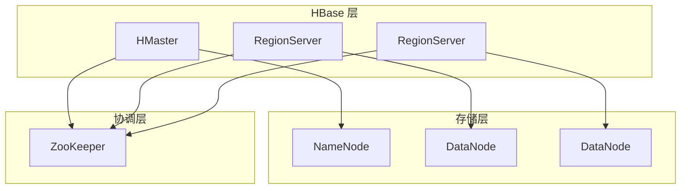
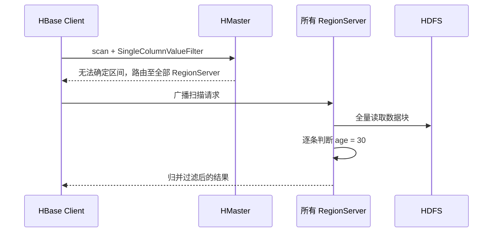

# 六大数据库存储实战: 用 Docker 部署 HBase 并跑通 Shell CRUD

## 纲要

- HBase 集群的组件构成：HDFS NameNode/DataNode、HMaster、RegionServer，以及社区镜像带来的部署简化
- Docker 启动 HBase 容器时必须暴露的四个端口及其用途
- HBase 的 DDL：建表必须指定列簇，列簇可以后加，列不需要预定义
- 写入语义：`put` 兼有 insert 与 update 的语义
- 读取语义：`get` 主键查询、`scan` 全表扫描、`startRow`/`stopRow` 左闭右开、`LIMIT` 截断、`SingleColumnValueFilter` 过滤
- 从命令行行为反推 HBase 的能力边界

## HBase 集群由什么组成

一套完整的 HBase 部署至少包含三层：



- **HDFS**：提供底层文件存储，NameNode 管元数据，DataNode 存实际数据块
- **HMaster**：负责表结构与 Region 分配，元数据存放在 ZooKeeper 中
- **RegionServer**：承载真正的数据读写，Region 是数据分片的最小单位
- **ZooKeeper**：保存集群的路由元数据与选主信息

手工搭建这套东西成本不低，社区已经把整套集群打进了 Docker 镜像，本地验证可以直接复用。

## 用 Docker 启动本地集群

```shell
# 拉取集成镜像（约数百 MB，视网络情况需要等待）
docker pull harisekhon/hbase:latest

# 启动容器并暴露关键端口
docker run -d --name hbase \
  -p 2181:2181 \
  -p 16010:16010 \
  -p 16020:16020 \
  -p 16030:16030 \
  harisekhon/hbase:latest
```

四个端口的分工：

| 端口 | 用途 |
| --- | --- |
| 2181 | ZooKeeper 端口，HBase Client 通过它建立连接 |
| 16010 | HBase Web 控制台，可查看 Master、RegionServer、用户表与软件属性 |
| 16020 | RegionServer 服务端口 |
| 16030 | RegionServer 信息端口 |

容器启动后访问 `http://localhost:16010`，可以看到一个 Master 节点与若干 RegionServer，也可以查到当前已有的用户表。控制台只解决"看得见"的问题，真正的增删改查要进 Shell。

```shell
docker exec -it hbase /bin/bash
hbase shell
```

首次进入会有一段加载过程，连接成功后即可执行命令。

## DDL：列簇必须预定义

先创建一张 `student` 表，包含两个列簇：

```shell
create 'student', 'baseinfo', 'schoolinfo'
```

这里最容易被误解的一点是：**HBase 是列式存储，但列不是离散管理的，必须绑定到列簇**。同一个列簇下的所有列会存储在相同的 StoreFile 中，列簇的物理划分决定了 IO 的聚合方式。

建表耗时在秒级，因为它要同时在 HMaster 的元数据、RegionServer 以及底层 HDFS 上完成创建，等价于 MySQL 中的 `CREATE TABLE`。

列簇可以后续追加：

```shell
alter 'student', {NAME => 'teacherinfo'}
```

追加列簇是 DDL 级别的变更，而**列不需要任何预定义**——这正是 HBase 弱结构特性的体现：写入时给一个 `列簇:列名` 的组合，列就自动产生了。

查看表结构：

```shell
describe 'student'
```

输出会列出 `baseinfo`、`schoolinfo`、`teacherinfo` 三个列簇及其属性。

## 写入：put 兼有 insert 与 update

```shell
put 'student', '1', 'baseinfo:name', 'mike'
put 'student', '1', 'baseinfo:age', '30'
put 'student', '1', 'baseinfo:birthday', '2010-11-20'
put 'student', '1', 'schoolinfo:name', '复旦 University'
put 'student', '1', 'schoolinfo:location', '上海'

put 'student', '2', 'baseinfo:name', 'tea'
put 'student', '2', 'baseinfo:age', '31'
put 'student', '2', 'baseinfo:birthday', '2010-11-09'
put 'student', '2', 'schoolinfo:name', '清华大学'
put 'student', '2', 'schoolinfo:location', '北京'
```

第一个参数是 RowKey（HBase 的主键），第二个参数是 `列簇:列名`。同一个 RowKey + 列的组合重复写入即为更新，不存在则插入——也就是说 `put` 同时覆盖了 MySQL 里 `INSERT` 与 `UPDATE` 两种语义，没有独立的 update 语句。

## 读取一：get 主键查询

```shell
# 取整行
get 'student', '1'

# 只取某个列簇
get 'student', '1', 'baseinfo'

# 精确到列
get 'student', '1', 'baseinfo:name'
```

返回结果中每一列都会带一个时间戳，这是 HBase 多版本机制的体现：同一列的每次写入都会保留版本，默认返回最新版本。

即便是最快的主键查询，本地单机环境也要消耗几十毫秒，因为它包含了 ZooKeeper 寻址、Region 定位以及 HDFS 读取三段开销。这与 MySQL 主键查询的量级完全不同，选型时要提前有心理预期。

## 读取二：scan 与范围限定

不带任何条件的 `scan` 就是全表扫描：

```shell
scan 'student'
```

返回所有 RowKey 的所有列，并且按 RowKey **字典序升序**排列——注意是字符串序，不是数字序。

限定输出列：

```shell
scan 'student', {COLUMNS => 'baseinfo:birthday'}
```

限定 RowKey 区间：

```shell
# 左闭右开：能查到 1，查不到 2
scan 'student', {STARTROW => '1', STOPROW => '2'}

# 想要包含 2，需要把 STOPROW 设为 3
scan 'student', {STARTROW => '1', STOPROW => '3'}
```

`STARTROW` 与 `STOPROW` 是 HBase 的一等公民：因为 Region 本身就是按 RowKey 区间划分的，HMaster 可以直接根据区间定位目标 RegionServer，避免把请求广播到所有节点。这是 HBase 中**唯一具备索引性质**的查询条件。

加上条数截断：

```shell
scan 'student', {STARTROW => '1', STOPROW => '3', LIMIT => 1}
```

## 读取三：条件过滤的真实代价

想表达"年龄等于 30"这种类似 SQL `WHERE` 的语义，要用过滤器：

```shell
scan 'student', {FILTER => "SingleColumnValueFilter('baseinfo','age',=,'binary:30')"}
```

语法上它确实等价于 `WHERE age = 30`，但执行路径完全不同：



HBase 没有二级索引，也没法在 `age` 上建索引树。所谓"过滤"是在 RegionServer 侧把数据从 HDFS 读出来之后逐条比对、再归并返回。数据量一大，这个代价非常可观。

这也解释了为什么 HBase 的 RowKey 设计如此关键：能落进 `STARTROW`/`STOPROW` 的条件才有分区剪枝能力，落不进的一律全表扫描。

## 各操作的代价对比

| 操作 | 是否走分区剪枝 | 典型耗时量级 | 适用场景 |
| --- | --- | --- | --- |
| `get 'rowkey'` | 是，直接定位 Region | 毫秒级 | 已知主键的单条查询 |
| `scan` + `STARTROW`/`STOPROW` | 是，按区间定位 | 十毫秒级 | 列表拉取、分页 |
| `scan` + `COLUMNS` | 否，但减少网络传输 | 与数据量成正比 | 只需要少数字段 |
| `scan` + `SingleColumnValueFilter` | 否，全表扫描 | 与全表数据量成正比 | 低频、离线类查询 |

## 命令行背后的能力边界

通过这一轮 CRUD 演练，HBase 的画像已经很清晰：

- 有且只有一个索引，就是 RowKey；
- 写入极其廉价，`put` 是追加语义，天然适合高并发写入；
- 查询能力被 RowKey 严格约束，脱离 RowKey 的条件查询会退化为全表扫描；
- 结构极其灵活，列随时扩展，但列簇的划分要一次性想清楚。

所以 HBase 的正确用法是：在设计阶段就把访问路径翻译成 RowKey，让所有在线查询都能落到 `get` 或有限区间的 `scan` 上。

## API 速览

| Shell 命令 | 语义 |
| --- | --- |
| `create '表名', '列簇'...` | 建表，必须指定至少一个列簇 |
| `alter '表名', {NAME => '列簇'}` | 追加列簇 |
| `describe '表名'` | 查看表结构与列簇属性 |
| `put '表名','rowkey','列簇:列','值'` | 插入或更新单个单元格 |
| `get '表名','rowkey'[,'列簇'[,'列']]` | 主键查询，可逐级收敛粒度 |
| `scan '表名', {选项}` | 扫描，支持 `COLUMNS`/`STARTROW`/`STOPROW`/`LIMIT`/`FILTER` |
| `SingleColumnValueFilter('列簇','列',操作符,'binary:值')` | 单列值过滤器，全表扫描式执行 |

## Demo 示例

### 运行说明

本地有 Docker 即可完整复现，不需要额外依赖：

```shell
docker run -d --name hbase -p 2181:2181 -p 16010:16010 -p 16020:16020 -p 16030:16030 harisekhon/hbase:latest
docker exec -it hbase hbase shell
```

### 一键脚本

```shell
#!/usr/bin/env bash
# 根据讲稿逻辑补充：HBase Shell CRUD 冒烟脚本
set -e

hbase shell <<'EOF'
create 'student', 'baseinfo', 'schoolinfo'
alter 'student', {NAME => 'teacherinfo'}
describe 'student'

put 'student', '1', 'baseinfo:name', 'mike'
put 'student', '1', 'baseinfo:age', '30'
put 'student', '1', 'baseinfo:birthday', '2010-11-20'
put 'student', '1', 'schoolinfo:name', 'Fudan University'
put 'student', '1', 'schoolinfo:location', 'Shanghai'

put 'student', '2', 'baseinfo:name', 'tea'
put 'student', '2', 'baseinfo:age', '31'
put 'student', '2', 'baseinfo:birthday', '2010-11-09'
put 'student', '2', 'schoolinfo:name', 'Tsinghua University'
put 'student', '2', 'schoolinfo:location', 'Beijing'

get 'student', '1'
get 'student', '1', 'baseinfo'
get 'student', '1', 'baseinfo:name'

scan 'student'
scan 'student', {COLUMNS => 'baseinfo:birthday'}
scan 'student', {STARTROW => '1', STOPROW => '2'}
scan 'student', {STARTROW => '1', STOPROW => '3', LIMIT => 1}
scan 'student', {FILTER => "SingleColumnValueFilter('baseinfo','age',=,'binary:30')"}
EOF
```

### 代码说明

- 脚本按 DDL → DML → 查询 → 过滤的顺序执行，对应上文每一节的命令；
- `STARTROW => '1', STOPROW => '2'` 只返回 RowKey 为 `1` 的记录，用来验证左闭右开；
- `SingleColumnValueFilter` 一行用来观察"看似有条件、实为全表扫描"的行为。

### 技术点总结

- HBase 部署的复杂度在镜像里被抹平，但端口语义必须清楚，尤其是 2181（ZooKeeper）与 16010（控制台）；
- 列簇是物理存储单位，要预先设计；列是逻辑扩展单位，随时可加；
- `put` 无差别覆盖插入与更新；`get` 是唯一廉价查询；`scan` 脱离 RowKey 区间就必然全表扫描；
- 命令行是理解 HBase 能力边界最快的途径：它把所有查询能力都摊在了 RowKey 这一根轴上。

相关度：90%。是否需要继续：[是]。代码是否可运行：[是]。
