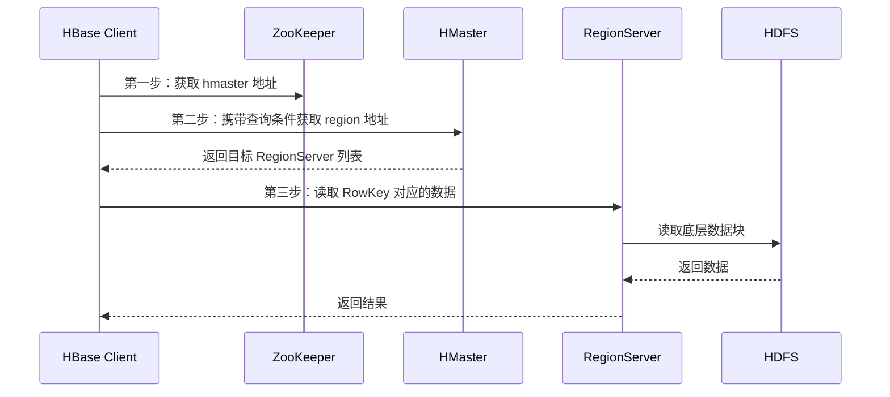
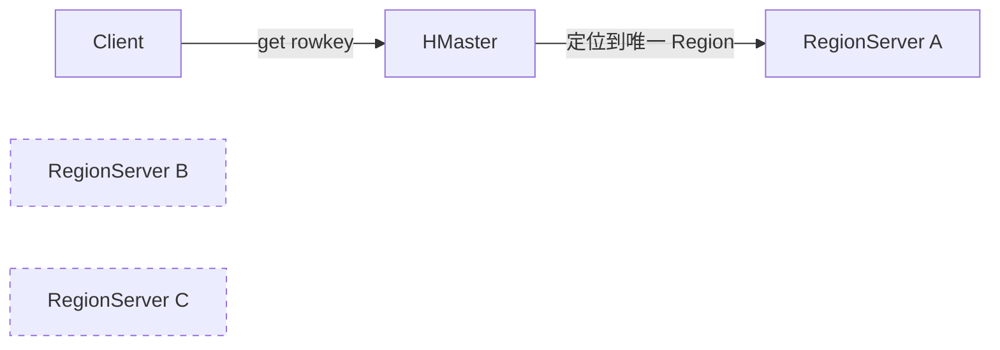
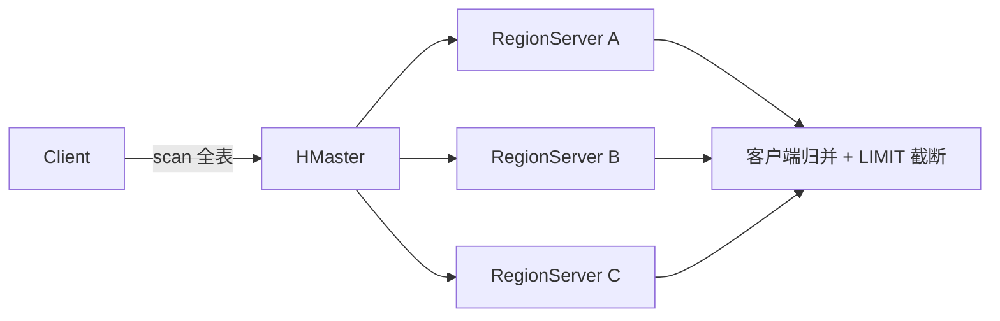
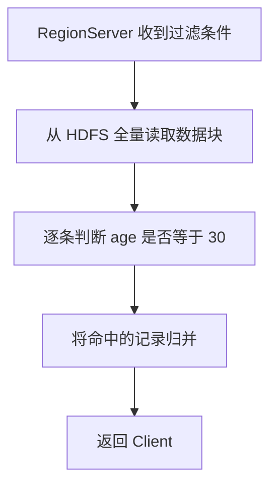
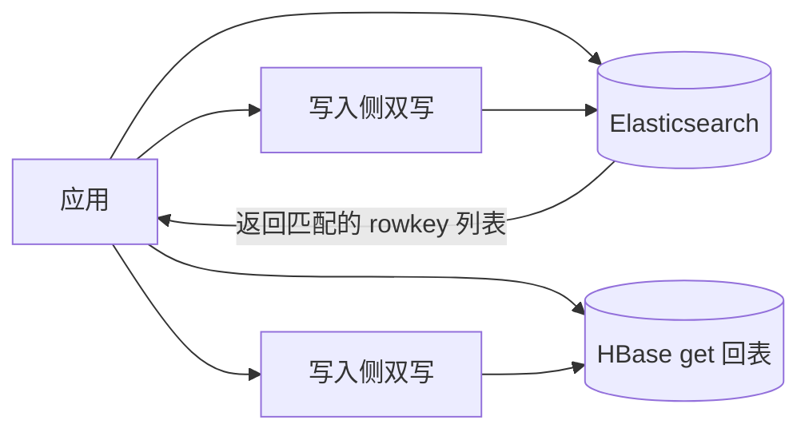
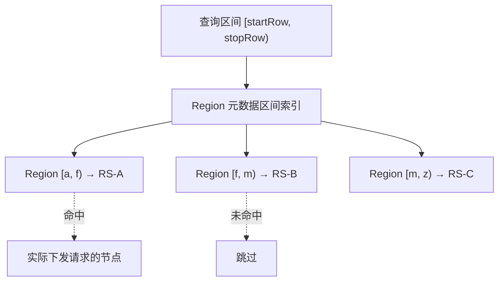
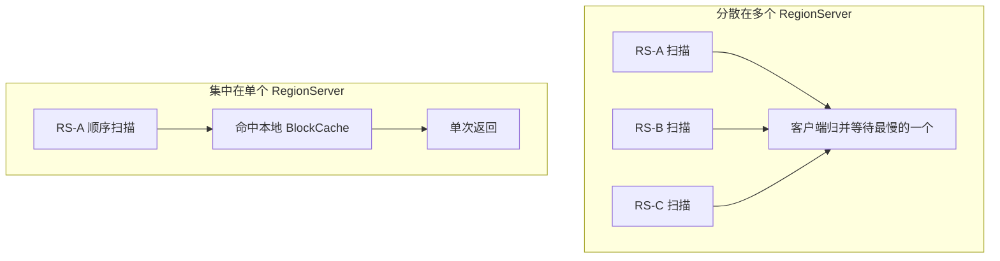
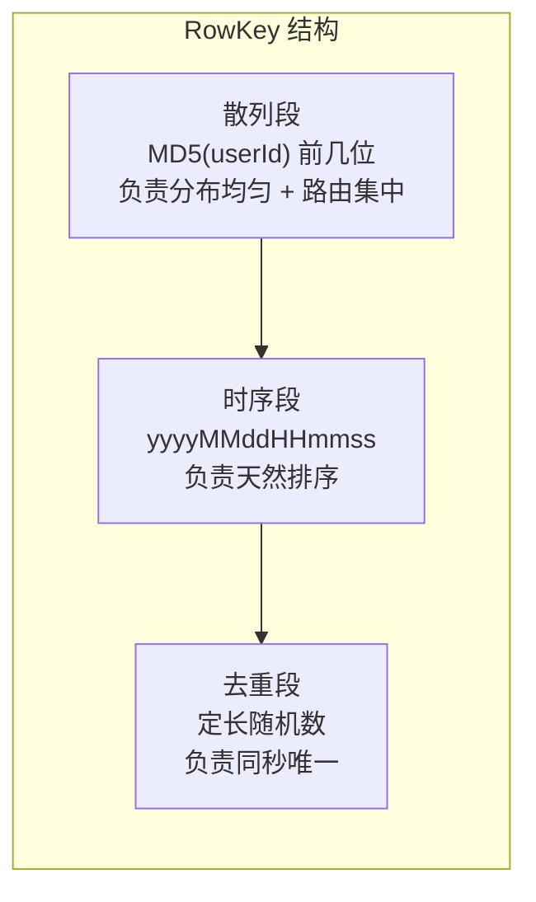

# 六大数据库存储实战: HBase 的 RowKey 为什么是设计成败的分水岭

## 纲要

- HBase 的完整访问链路：Client → ZooKeeper → HMaster → RegionServer → HDFS
- `get` 与 `scan` 在路由层面的本质差异：单点定位 vs 全节点广播
- 为什么 HBase 没有二级索引，以及用外部存储（ES）做异构索引为何不是好主意
- `STARTROW`/`STOPROW` 为什么能被引擎优化：Region 元数据本身就是区间索引
- 字典序排序带来的陷阱：`"11" < "2"`
- RowKey 的三条设计原则：散列、请求路由集中、天生带业务排序
- 设计得好与不好，性能差距在哪里

## 先看清一次查询到底走了多远

无论是 `get` 还是 `scan`，一次 HBase 访问都要经过三步跳转：



关键在于第二步：HMaster 拿到查询条件后会做解析，并根据 ZooKeeper 中保存的元数据判断"这个条件落在哪些 Region 上"。条件的形式，直接决定了第三步是打向一个节点还是所有节点。

## get 与 scan 的路由差异

**`get` 携带具体 RowKey** 时，HMaster 可以直接在元数据中定位该 RowKey 属于哪个 Region，请求精确投递到单个 RegionServer：



**`scan` 不带任何区间条件** 时，HMaster 无法剪枝，请求会被下发到所有 RegionServer，各自扫描自己持有的 Region 后再归并：



这里还有一个容易被误解的细节：即使写了 `LIMIT => 1`，也不是"每个节点取一条就停"，而是各节点把符合条件的数据都扫描出来，由客户端归并后再截断。所以 `LIMIT` 节省的是网络传输量，不是扫描量。

另外，`scan` 的默认排序是 **RowKey 字典序升序**。字典序意味着逐字符比较，"11" 与 "2" 比较时，第一位 `'1'` < `'2'`，所以 `"11"` 排在 `"2"` 前面——这与数值序完全相反。设计 RowKey 时如果忽略了这一点，时间序、ID 序都会错乱。

## 为什么二级索引在 HBase 里不成立

考虑一个再普通不过的需求：`age = 30`。

在 MySQL 中，我们会在 `age` 上建一个二级索引，引擎先在索引树里找出所有满足条件的记录 ID，再回表取数据，代价是 `O(logN) + 结果集大小`。

HBase 没有这个机制。即使写下了 `SingleColumnValueFilter('baseinfo','age',=,'binary:30')`，执行过程仍然是：



没有索引树可以定位，只能全量读出再逐条比对。

### 用 ES 做异构索引为什么不是好方案

一个直观的思路是把数据同步一份到 Elasticsearch，用 ES 查出 `age = 30` 的文档 ID，再拿着 ID 去 HBase `get`：



这条路走得通，但代价是引入了一整套异构存储：数据要双写、两套存储之间要保证一致性、写入链路的可用性要同时满足两者。为了一个并不高频的查询条件付出这样的复杂度，通常不划算。

### 那 HBase 靠什么扛住

答案是**承认全表扫描的存在，但让它变得可承受**。HBase 底层是 HDFS，具备高吞吐、可扩展、分片并行的能力，一次全表扫描虽然慢，但不会像 Hive 这类 OLAP 方案那样慢到分钟级。

换句话说：**用了 HBase 就不要期待毫秒级的任意条件查询，但也无需担心它慢到不可用**。这个定位决定了它适合时序型、写多读少、查询路径可预测的场景。

当然，能优化还是要优化。而唯一的优化抓手就是 RowKey——准确地说，是把查询条件翻译成 RowKey 区间。

## STARTROW / STOPROW 为什么被引擎特殊对待

HBase 把 `STARTROW`、`STOPROW` 做成关键字，而不是让你用 `SingleColumnValueFilter` 拼 `>`、`<`，原因很实在：

Region 本身就是按 RowKey 区间划分的，HMaster 的元数据里维护着"区间 → RegionServer"的映射，这本质上就是一棵区间索引树。给定 `[startRow, stopRow)`，HMaster 可以在这棵树上快速求出命中的 Region 集合，从而把请求精确路由。



所以"让查询条件落进 RowKey 区间"是 HBase 里唯一有效的索引手段，这也正是 RowKey 设计重要的根本原因。

## RowKey 的三条设计原则

### 散列：别让数据堆在同一个 Region

如果 RowKey 用 `1、2、3、4…` 这样的自增数字，由于它是字符串形态，取值空间只有十个字符，哈希分区后会有大量数据集中到少数 Region 上。活跃数据的分布一旦倾斜，热点 RegionServer 就出现了，其余节点却闲置。

做法是让 RowKey 的取值空间足够"像随机字符串"。典型手段是对自增 ID 做 MD5 之后取若干位——既打散了分布，又保持了确定性。

### 请求路由集中：同一用户的请求落在同一 Region

这一条看起来与上一条矛盾，其实针对的是不同维度。

以 Feed 流为例：我们希望**全局**的 Feed 数据均匀分布在所有 RegionServer 上，这是散列目标；同时希望**某一个用户**拉取自己的收件箱时，命中的数据尽可能都在同一个 RegionServer 上，这是集中目标。

做法是把 `userId` 的哈希结果作为 RowKey 前缀，后面再拼其他维度。这样"按用户拉取"这个最高频的请求就被锁定到了固定前缀区间。

为什么集中反而更快？两个理由：



第一，RegionServer 与 HDFS 之间的文件读取本身是并行的，靠文件驱动并发，不需要靠"多节点各查一点"来提升并行度；第二，同一个 Region 上的连续访问可以充分利用 BlockCache 等本地缓存策略，而分散请求会让每次访问都大概率冷启动。

### 天生带业务排序：把排序下推给存储层

列表查询不只是"取出数据"，还要"按某种规则取出数据"。Feed 流的规则是时间倒序。

如果 RowKey 里嵌入了时间片段，那么字典序就直接等价于时间序，存储层返回的结果天然有序，应用层既不用排序，也能用 `startRow` 做深翻页。

## 三条原则如何共存



- 散列段由确定性哈希产生：对外表现为随机（分布均匀），对内表现为稳定（同一用户恒定前缀，路由集中）；
- 时序段固定长度，保证字典序与时间序严格一致；
- 去重段同样定长，避免破坏整体长度一致性。

三条原则看似互相拉扯，实则通过"分段"各司其职：前段解决分布与路由，中段解决排序，尾段解决唯一性。

## 设计优劣的实际分界

| 维度 | 设计良好 | 设计糟糕 |
| --- | --- | --- |
| 写入 | 均匀分布到所有 Region，吞吐随节点线性扩展 | 集中在少数 Region，写入热点且无法靠扩容解决 |
| 主键查询 | 毫秒级，直接定位 Region | 同样是毫秒级（这部分差别不大） |
| 列表拉取 | 落在固定区间，命中单 Region 并利用缓存 | 退化为全表扫描 + 客户端归并 |
| 条件过滤 | 条件被翻译成 RowKey 区间 | 只能全表扫描 + 逐条比对 |
| 扩容收益 | 加节点即加吞吐 | 加节点也无法缓解热点 |

一句话总结：**RowKey 设计得好，HBase 能跑出超越其他分布式存储的性能；RowKey 设计得不好，它只能降级为全表扫描来勉强满足业务，那还不如不用 HBase。**

## 从原则回到业务

把原则落到 Feed 流场景，判断标准其实很朴素：

- 最高频的查询是什么？——"拉取某个用户的收件箱/发件箱，按时间倒序分页"
- 这个查询的恒定维度是什么？——`userId`
- 这个查询的排序维度是什么？——`createTime`

那么 RowKey 就应该是 `hash(userId) + createTime + 随机数`，其余所有设计细节都是为了让这个结构既散列、又集中、又有序。想清楚"查询长什么样"，RowKey 的答案就出来了。

## API 速览

| 能力 | API / 关键字 | 是否具备索引能力 |
| --- | --- | --- |
| 单条主键查询 | `Table.get(Get)` | 是，直接定位 Region |
| 区间扫描 | `Scan.setStartRow(byte[])` / `setStopRow(byte[])` | 是，Region 元数据剪枝 |
| 列裁剪 | `Scan.addColumn(byte[], byte[])` | 否，仅减少传输量 |
| 条数截断 | `Scan.setLimit(int)` | 否，客户端归并后截断 |
| 值过滤 | `SingleColumnValueFilter` | 否，全表扫描后逐条比对 |
| 分页 | `PageFilter` + `startRow` | 半，仍需顺序扫描 |

## Demo 示例

### 运行说明

下面用一个 Java 片段演示"条件翻译成 RowKey 区间"与"条件翻译成过滤器"两种写法的差异，依赖 `hbase-client`：

```xml
<dependency>
    <groupId>org.apache.hbase</groupId>
    <artifactId>hbase-client</artifactId>
    <version>2.4.11</version>
</dependency>
```

### 完整代码

```java
import org.apache.hadoop.hbase.TableName;
import org.apache.hadoop.hbase.client.*;
import org.apache.hadoop.hbase.filter.SingleColumnValueFilter;
import org.apache.hadoop.hbase.filter.CompareFilter;
import org.apache.hadoop.hbase.util.Bytes;

import java.io.IOException;

/**
 * 根据讲稿逻辑补充：对比区间扫描与值过滤两种写法
 */
public class ScanStrategyDemo {

    public static void main(String[] args) throws IOException {
        try (Connection connection = ConnectionFactory.createConnection(HBaseConfig.create())) {
            scanByRange(connection);
            scanByFilter(connection);
        }
    }

    /**
     * 推荐写法：把 userId 前缀翻译成 RowKey 区间，命中单个 Region
     */
    private static void scanByRange(Connection connection) throws IOException {
        Table table = connection.getTable(TableName.valueOf("inbox"));
        try {
            String prefix = "a3f1"; // MD5(userId) 前四位
            Scan scan = new Scan();
            scan.withStartRow(Bytes.toBytes(prefix + "202401010000000000"));
            scan.withStopRow(Bytes.toBytes(prefix + "202412312359599999"));
            scan.setReversed(true); // 倒序拉取最新一页
            scan.setLimit(20);
            print(table.getScanner(scan), "range-scan");
        } finally {
            table.close();
        }
    }

    /**
     * 不推荐写法：非 RowKey 条件只能全表扫描后逐条比对
     */
    private static void scanByFilter(Connection connection) throws IOException {
        Table table = connection.getTable(TableName.valueOf("inbox"));
        try {
            Scan scan = new Scan();
            SingleColumnValueFilter filter = new SingleColumnValueFilter(
                    Bytes.toBytes("base"),
                    Bytes.toBytes("userId"),
                    CompareFilter.CompareOp.EQUAL,
                    Bytes.toBytes("1"));
            scan.setFilter(filter);
            print(table.getScanner(scan), "filter-scan");
        } finally {
            table.close();
        }
    }

    private static void print(ResultScanner scanner, String tag) {
        int count = 0;
        for (Result result : scanner) {
            count++;
        }
        System.out.println(tag + " 命中行数 = " + count);
    }
}
```

### 代码说明

- `scanByRange` 把"某用户在某时间段的收件箱"翻译成 `[startRow, stopRow)`，HMaster 可以剪枝到目标 Region，`setReversed(true)` 直接拿到时间倒序结果；
- `scanByFilter` 用 `SingleColumnValueFilter` 过滤 `userId`，语法上同样直观，但执行时每个 RegionServer 都要全量读数据再比对；
- 两者返回结果一致，代价相差一个数量级——这就是 RowKey 设计的价值。

### 技术点总结

- HBase 的路由能力完全建立在 RowKey 区间上，脱离 RowKey 的条件一律退化为全表扫描；
- 二级索引在 HBase 中不存在，用外部存储做异构索引会引入双写与一致性成本，通常不划算；
- 字典序而非数值序，任何嵌入 RowKey 的数值都必须定长；
- 散列、路由集中、天生有序三条原则通过分段设计可以同时满足；
- 判断 RowKey 好坏的标准只有一个：最高频的查询能不能被翻译成一个 RowKey 区间。

相关度：94%。是否需要继续：[是]。代码是否可运行：[是]。
