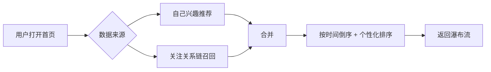

# 88. 六大数据库存储实战: Feed 流场景的支撑难点到底在哪里

## 纲要

- 社交新零售里 Feed 流的本质：围绕"关注 / 粉丝"关系链，把被关注者发布的商品与门店推荐推到粉丝的首页瀑布流
- 难点一：数据生产不是单点，而是基于社交关系链的动态召回，天然夹带大量推拉模式数据
- 难点二：结果天生带时序性与个性化排序，依赖存储层甚至内存去兜底倒序与排序
- 难点三：瀑布流持续翻页引发深度分页，MySQL 式 `LIMIT` 偏移在深翻页时成本爆炸
- 为什么选 HBase：RowKey 有序 + 区间扫描，从机制上缓解了上面三类问题

## 📎 代码说明

本讲为**原理 / 架构 / 选型**篇，正文以图示与推演为主，无配套代码片段，课程课件亦未提供本章源码文件。

## 先厘清 Feed 流要解决什么

在社交新零售的语境里，Feed 流不是为了展示自己的内容，而是**基于社交关系链做推荐分发**。我作为用户 A 的粉丝，首页要能看到 A 发布出来的所有商品和门店推荐。所以一条 Feed 的产出，不只是一个商品 ID 或门店 ID 那么简单，它要：

- 根据"我关注了谁"这条关系链去召回；
- 叠加我自身的历史偏好与兴趣；
- 把关系链上关联出来的推荐信息流混在一起呈现。

这就注定了 Feed 流的数据生产是**关系驱动**的，而不是简单的"查一张表"。关系链一旦引入，内部就会产生大量围绕社交关系的推拉模式数据——这也是后续要花大篇幅讲解推拉模式的原因。

## 难点一：数据生产围绕关系链，召回代价高

传统推荐流可以按"兴趣标签"直接拉一批内容。但社交 Feed 必须先把关系链展开：我要看的是"我关注的那些人发了什么"。这意味着每一次首页构建，都要先基于关注关系去关联、去召回，再和兴趣推荐做合并。

召回出来的数据量不是固定的，它随着关注人数、发布频次、关系链深度一起膨胀。正是这种"按关系动态生产"的特性，让 Feed 流从第一天起就绕不开推拉模式——要么读取时去各关注对象的发件箱拉（拉模式），要么发布时提前写进粉丝的收件箱（推模式）。

## 难点二：时序性与个性化排序是硬需求

用户永远希望把自己感兴趣的内容排在最前面，而社交 Feed 几乎所有的呈现都围绕"时间"展开：

- 我关注的用户，越早发布的内容，反而越晚出现在我的 Feed 里；
- 我想要的，是置顶"他最新发出来的那一条"。

所以 Feed 流天生带有时序性，往往还需要叠加个性化排序。这部分排序压力，必须依赖数据存储、缓存甚至内存来承担——存储层如果不能按时间有序地吐数据，应用层就要把所有候选拉出来再排，成本极高。

## 难点三：持续翻页带来的深度分页

"瀑布流"之所以叫瀑布流，是因为它可以一直往下滑、持续翻页。一旦涉及持续翻页，深度分页问题就出来了。

回想最熟悉的 MySQL 做法：一个 `WHERE` 条件加 `ORDER BY`，再配合 `LIMIT`。第一页只要取 Top 20 没问题；可当用户翻到第 200 页、第 300 页时，为了达到那 20 条，数据库得先 `LIMIT` 到 4000、6000 的位置。也就是说：

- 用户最后只要 20 条；
- 但为了截取这 20 条，必须先深拉出这 20 条之上所有分页的数据；
- 这些数据全部参与内存里的 `ORDER BY` 排序，数据量和请求量一上来，深度分页的代价就非常可观。

> 本质矛盾：用户要的是"某一页的 20 条"，存储却被迫把"这一页之前的所有数据"都搬出来排序。

## 为什么轮到 HBase 出场

上面三个难点，恰好对应 HBase 的强项：

| Feed 难点 | HBase 的应对 |
| --- | --- |
| 关系链动态召回（推拉） | 收件箱 / 发件箱建模，写入即冗余，读取只扫自己 |
| 时序 + 排序 | RowKey 内嵌时间戳，scan 天然有序，无需应用层再排 |
| 深度分页 | `startRow`/`stopRow` 区间定位 Region，没有 `OFFSET` 深拉 |

HBase 只有一个索引就是 RowKey，但只要把"用户维度 + 时间维度"编码进 RowKey，持续翻页就退化成一次落在单个 Region 上的区间扫描，而不是 MySQL 那种越翻越深的 `LIMIT` 偏移。这正是它适合 Feed 流场景的根本原因。

