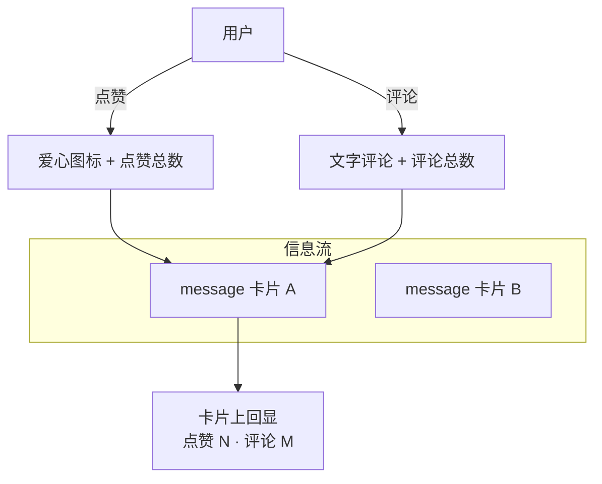
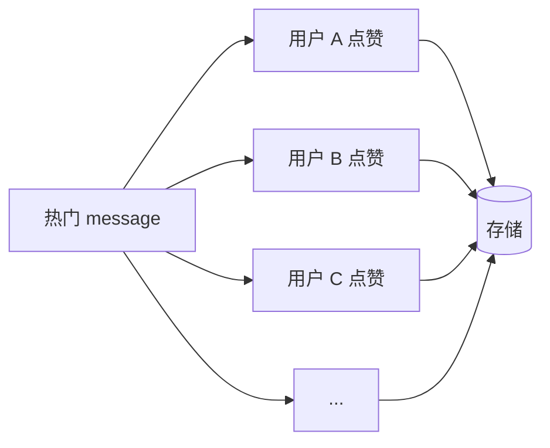
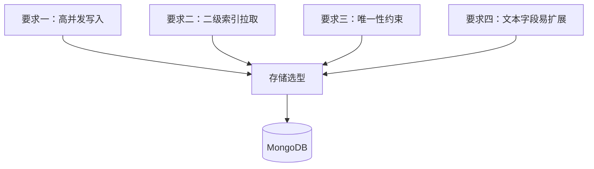
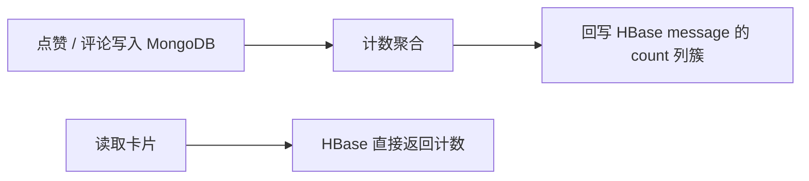

# 六大数据库存储实战: 点赞评论场景的能力拆解与选型切入点

## 纲要

- 点赞与评论在社交信息流中的产品位置：作用于 message 主体，以总数形式回显
- 点赞的行为特征：双击即写、高频、只记录引用关系
- 评论的行为特征：带文本内容、需要按 messageId 拉取列表
- 两类数据共同提出的两项硬性能力要求：扛住瞬时高并发写入、支持二级索引条件拉取
- 为什么这两项要求会把选型推向 MongoDB，而不是继续用 HBase

## 场景：点赞与评论到底在做什么

社交瀑布流里，用户看到的是一条条 message（消息卡片），每张卡片上有两个交互入口：

- **点赞**：用户双击屏幕就完成一次写入，卡片上回显一个爱心图标与点赞总数；
- **评论**：用户针对某条 message 输入文字，形成一条评论，卡片上回显评论总数，点进去还能看到评论列表。

这两个功能的业务目标很明确——**促活**。用户发布的消息被点赞、被评论，热度差异会直接体现在卡片上的两个数字上，从而驱动更多互动。

## 两种数据的结构差异

点赞与评论看似同类，数据结构上却有明显区别：

| 维度 | 点赞 | 评论 |
| --- | --- | --- |
| 核心字段 | `userId` + `messageId` | `userId` + `messageId` + `content` |
| 是否含文本 | 否 | 是，且长度不定 |
| 数据量级 | 极高，热门内容秒级成百上千 | 相对低，但仍远高于发布量 |
| 唯一性约束 | 一人一消息只能赞一次 | 无，可重复评论 |
| 读取形态 | 点赞总数 + 点赞用户头像列表 | 评论总数 + 评论内容列表 |

点赞只是一层"引用关系"：谁赞了哪条消息，加上时间。评论除了引用关系，还要承载文本内容，因此对存储格式有一定要求，需要能被快速存取。

## 场景提出的两项硬性能力

### 第一项：扛住瞬时高并发写入

点赞的触发成本极低——双击屏幕即可。一条热门内容可以在很短时间内涌入成百上千条点赞数据。这决定了存储必须能承接**大规模、高并发的写入**。

评论同理，只是量级稍低。

### 第二项：支持带二级索引的条件拉取

评论列表、点赞用户列表，本质上都是"某条 messageId 下的所有记录"。这是一个典型的**非主键维度的条件查询**——查询条件不是记录自身的主键，而是记录中的一个字段。

这要求存储具备二级索引能力：能像关系型数据库那样在某个字段上建索引，然后用 `WHERE messageId = ?` 快速拉出结果集。

## 为什么 HBase 承接不了这个场景

回顾上一章的 HBase，它的能力边界恰好卡在这两个要求上：

| 能力要求 | HBase 的表现 | 结论 |
| --- | --- | --- |
| 高并发写入 | 非常擅长，put 是追加语义 | 满足 |
| 二级索引 | 不支持，非 RowKey 条件只能全表扫描 | 不满足 |

HBase 唯一能加速查询的手段是把条件翻译成 RowKey 区间。"某条消息下的所有评论"这个条件勉强可以做成 `messageId + 时间戳` 的 RowKey，但一旦还要支持"按时间排序分页""按点赞用户拉取"，单一 RowKey 就无法兼顾了。

更关键的是，点赞需要一个**唯一性约束**：同一个用户对同一条消息只能赞一次。HBase 没有唯一索引，这个约束只能靠应用层先查再写，在高并发下存在竞态。

## 选型的切入点

把场景要求列清楚后，选型的目标就非常具体了：

- **要求一**要求写入路径足够短，不能有事务、redo/undo 日志这类拖累；
- **要求二**要求能在任意字段上建索引，这是"最像关系型数据库的非关系型数据库"的核心特征；
- **要求三**要求索引能带唯一性约束，让重复的点赞直接抛 `duplicate key`；
- **要求四**要求 schema 灵活——今天评论只有文本，明天要支持图片，不能为此重定义历史数据的表结构。

这四项共同指向 MongoDB：它支持二级索引与唯一索引，文档模型天然易扩展，同时因为放弃了跨文档事务而保持了极高的写入吞吐。

## 与已有架构的衔接

这里还有一个架构上的衔接点：上一章在 HBase 的 `message` 表中预留了 `likeCount` 与 `remarkCount` 两个字段。

也就是说，**明细数据存 MongoDB，聚合后的总数回写 HBase**。这样卡片展示时只需要读 HBase 一行就能拿到两个数字，不必每次都去 MongoDB 做 count。

这个设计也埋下了后续要解决的核心问题：计数回写 HBase 时，同一条 message 的计数更新会形成行级热点，必须靠脉冲方案削峰。

## 小结

- 点赞评论是社交场景最通用的促活能力，结构上分"引用关系"与"带文本的记录"两类；
- 场景提出两项硬要求：扛住瞬时高并发写入、支持二级索引条件拉取；
- HBase 能满足写入但满足不了索引，因此这一层要换存储；
- 唯一性约束、schema 灵活度进一步把选型推向 MongoDB；
- 明细在 MongoDB、总数回写 HBase 的分工，为后续的脉冲削峰埋下伏笔。

相关度：88%。是否需要继续：[是]。代码是否可运行：[否]。
