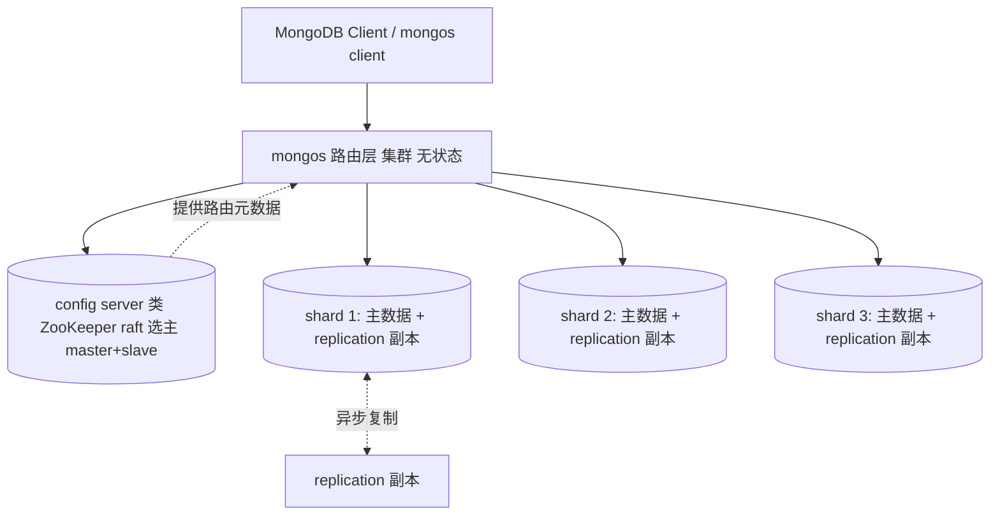

# 六大数据库存储实战: MongoDB 分布式扩展（分片集群）

## 纲要

- 单机有用户流量与存储上限，好的存储必须支持分布式无缝扩展——核心就是**分片（sharding）**
- 架构三组件：`mongos` 路由（无状态集群）、`config server`（类 ZooKeeper，raft 选主）、`shard`（数据节点，shard + replication）
- 路由信息存 `config server`，`mongos` 通过它知道文档落在哪个分片
- 每个集合必须指定**分片键**（如 `userId` / `messageId`）；分片键选定后不可随意调整，否则需 rebalance
- 整体形态与 Elasticsearch 集群高度相似（路由 + 配置 + 分片副本）

## 📎 代码说明

本讲为**原理 / 架构 / 选型**篇，正文以图示与推演为主，无配套代码片段，课程课件亦未提供本章源码文件。

## 为什么需要分布式扩展

任何存储如果不具备无缝的分布式扩展能力，迟早会在用户流量与存储容量上撞到瓶颈。MongoDB 的分布式能力，本质上就是一个关键词：分片——把数据拆到多个节点，而不是只靠单机。

## 分片集群的三种角色

MongoDB 的分片集群由三类服务组成，整体形态和 Elasticsearch 非常像：

### mongos 路由层

`mongos` 是路由服务，本身组成路由集群，且**无状态**。客户端（即前面用的 `MongoTemplate`）能够解析 MongoDB 的路由协议，选择一个 `mongos` 节点发起请求，由它负责路由。

### config server

配置服务可以理解为"MongoDB 的 ZooKeeper"，它本身也是集群。它内部使用类似 raft 的选举协议选出一个 master，其余为 slave。集群的路由元数据（每个集合的数据分片分布）都保存在这里。

### shard 数据节点

真正存数据的是 `shard` 节点，采用 **shard + replication** 的分法：一部分节点作为主数据存储，另一部分节点作为 replication 副本，二者通过异步复制协议保持副本一致。这点和 ES 的分片 + 副本机制如出一辙。

## 路由是怎么发生的

`mongos` 自身不存数据，它向 `config server`（无论 master 还是 slave）请求整个集群的路由元数据，从而知道"我要读写的某个文档，数据分片在哪一台 `shard` 上"。

因此一次读写的大致路径是：客户端 → 某个 `mongos` → 查 `config server` 拿到分片位置 → 路由到对应 `shard` 完成读写。

## 分片键是绕不开的设定

只要使用 `replication + shard` 架构，就**必须给每个集合指定分片键**（除了 `_id`，集合还需要自己的分片键）。实践中通常用 `userId`、`messageId` 这类字段做分片。

分片键一旦选定就**不能随意调整**：一旦调整，就需要对整个集群做 rebalance（重新均衡数据分布），成本很高。所以分片键的选择要在设计期想清楚。

## 与 Elasticsearch 的对照

整套分布式架构——不管 `mongos`、`config server` 还是 `shard` / `replication` 数据节点——都和 Elasticsearch 的"协调节点 + 主节点/配置 + 数据分片副本"非常相像。理解了 ES 集群，再理解 MongoDB 分片集群几乎没有认知门槛。

## 小结

- MongoDB 的分布式扩展靠分片，由 `mongos` 路由、`config server` 管元数据、`shard` 存数据三类角色组成；
- `mongos` 无状态、`config server` 用 raft 选主、`shard` 配 replication 副本，形态接近 ES；
- 使用分片架构必须指定分片键，且分片键不可随意变更，否则触发 rebalance；
- 分片让 MongoDB 突破单机流量与容量瓶颈，是其作为生产级存储的关键能力。

相关度：85%。是否需要继续：[是]。代码是否可运行：[否]。
