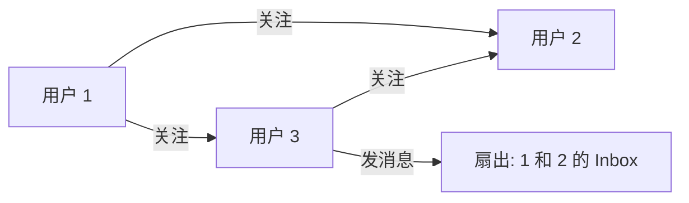
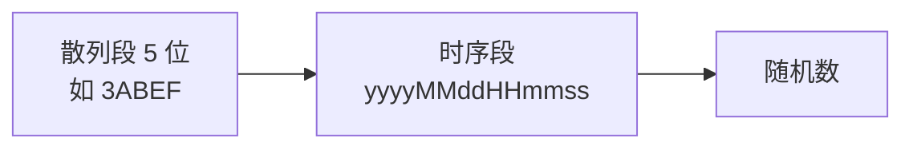

# 99. 六大数据库存储实战: 推模式写路径的端到端联调验证

## 纲要

- 联调目标：确认"发布消息 → 写 Outbox + 扇出 Inbox"的推模式链路真正跑通
- 前置：用关注关系制造扇出（1 关注 2、3 关注 2、1 关注 3，于是 3 发消息时 1 和 2 都应收到 Inbox）
- 坑一：messageService 漏调 boxService，导致 Outbox / Inbox 一条都没写——补上 autowire 与调用
- @Async 让 inbox / outbox 的写入整体异步化，发布接口不必等落库
- 坑二：Inbox 的 userId 误用 getNodeID（图节点内部 id）而非 getId（用户 id），导致收件人错乱——改回 getId
- RowKey 实测结构：散列段（5 位）+ yyyyMMddHHmmss + 随机数
- 大 V 短路实测：把用户 2 假设为大 V，写入时直接 return，Outbox 有、Inbox 无

## 📎 代码说明

本讲代码以**内联片段**形式呈现在正文中。课程课件仅发布第 2/3/4 章（MySQL 核心能力）的完整工程源码，本讲所属章节未随课件发布独立源码文件，故不做外部文件关联，请以正文片段为准。

## 先铺好关注关系

推模式是否成立，取决于有没有粉丝可扇出。我们先用接口把关注关系搭起来：用户 1 关注 2、用户 3 关注 2、用户 1 关注 3。这样当用户 3 发一条 message 时，关注了 3 的 1 和 2 都应该收到 Inbox。



用 Postman 调 `follow` 接口（`followUserId=2&followedUserId=3` 等）即可完成绑定，接口本身在前面 userController 中已实现。

## 坑一：忘了调用 boxService

发布 message 后去 HBase shell 看 `spmessage`（消息实体表）、`outbox`、`inbox`：消息实体写进去了，但 outbox 居然是空的，inbox 更没有。原因很直接——`messageService` 里压根没调用写箱子的逻辑。

补上注入与调用即可：

```java
@Autowired
private BoxService boxService;

// 在消息落库之后调用扇出
boxService.putBox(messageInfo);
```

由于 `boxService` 上标了 `@Async`，inbox 与 outbox 的写入整体异步化：发布接口立刻返回，箱子写入在后台线程完成，读取侧不需要等它落库。

## 坑二：收件人 userId 取错

重新发布后，outbox 正常了，但 inbox 里的 `userId` 看着不对——出现了 `4`、`8` 这类值。排查 `InboxInfo` 的代码发现：

```java
inbox.setUserId(fan.getNodeId().intValue()); // 错：取的是图节点内部 id
```

`getNodeId()` 拿到的是 Neo4j 图节点的内部 id，不是我们业务里的用户 id。应当用用户实体自己的主键：

```java
inbox.setUserId(fan.getId().intValue()); // 对：取用户业务 id
```

改完重启再发，inbox 里两个 `userId` 终于变成 `1` 和 `2`——代表这两个用户的收件箱都被正确投放了。

> 这是个极易踩的坑：Outbox 用发布者 id，Inbox 用粉丝的**用户 id**，字段名都叫 `userId` 但语义不同，写反了整条链路就错。

## RowKey 结构实测

从 HBase shell 里把 RowKey 打出来看，它并不是一串乱码，而是三段拼接：



- 第一段是 RowKey 生成器做的散列（`3ABEF` 这种 5 位串），负责把热点打散；
- 第二段是发布时间，保证同用户的消息天然按时间有序；
- 第三段随机数用于同一秒内的去重，避免 RowKey 冲突。

outbox 与 inbox 共用同一套生成器，只是 `userId` 的语义不同（发布者 vs 接收者），因此两边排序口径完全一致。

## 大 V 短路实测

推模式最怕大 V：一个几百万粉丝的用户发一条消息，就要往几百万个 Inbox 写扩散。我们在代码里做一次"假设"来演示短路：把用户 2 设为大 V，发布时直接 `return`，不扇出 inbox。

```java
// 在 putBox 扇出之前判断
if (outbox.getUserId().intValue() == 2) {
    // 假设用户 2 是大 V：只写 Outbox，不写 Inbox，写放大挡在门外
    return;
}
```

用用户 2 发一条消息后回 HBase shell 验证：outbox 多了一条（用户 2 的发布记录），inbox 数量纹丝不动——证明大 V 的收件箱扇出被成功短路，读取时这部分只能改走拉模式去查大 V 的 Outbox。

## 验证结论

至此推模式的**写路径**被完整跑通并得到实测确认：

| 验证项 | 结果 |
| --- | --- |
| 关注关系 → 扇出目标 | 1、2 正确收到 3 的 Inbox |
| boxService 调用缺失 | 已补，outbox / inbox 正常写入 |
| userId 取错 | 改回 `getId`，收件人不串 |
| RowKey 三段结构 | 散列 + 时序 + 随机数，符合设计 |
| 大 V 短路 | Outbox 有、Inbox 无，符合预期 |

下一步要解决的，是读取侧如何把"自己 Inbox 的 N 条"和"大 V Outbox 拉的 N 条"合并排序，也就是**推拉混合**的拉取实现。

