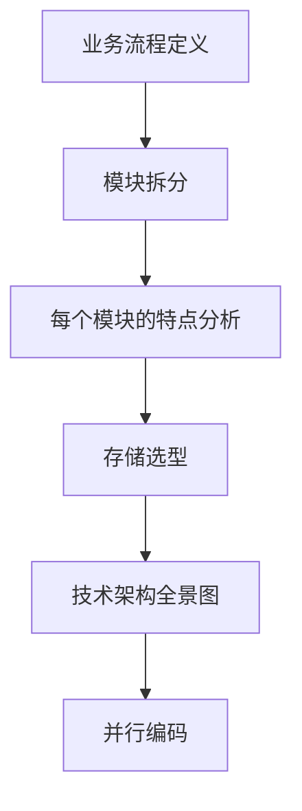
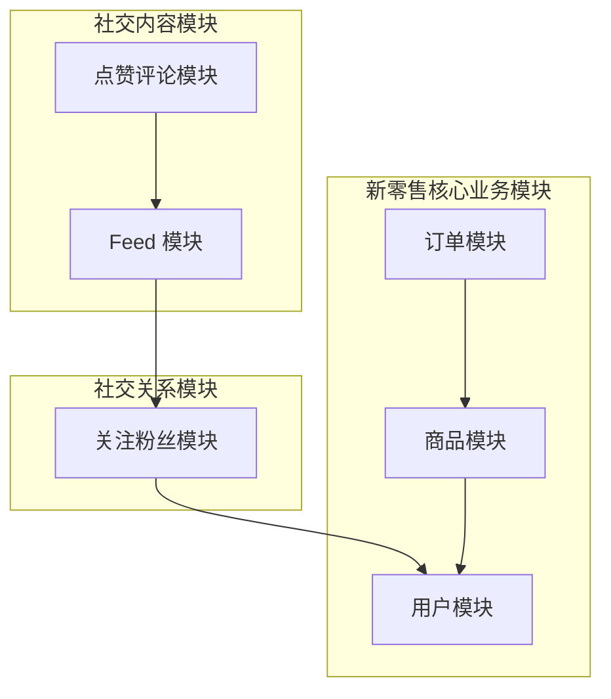
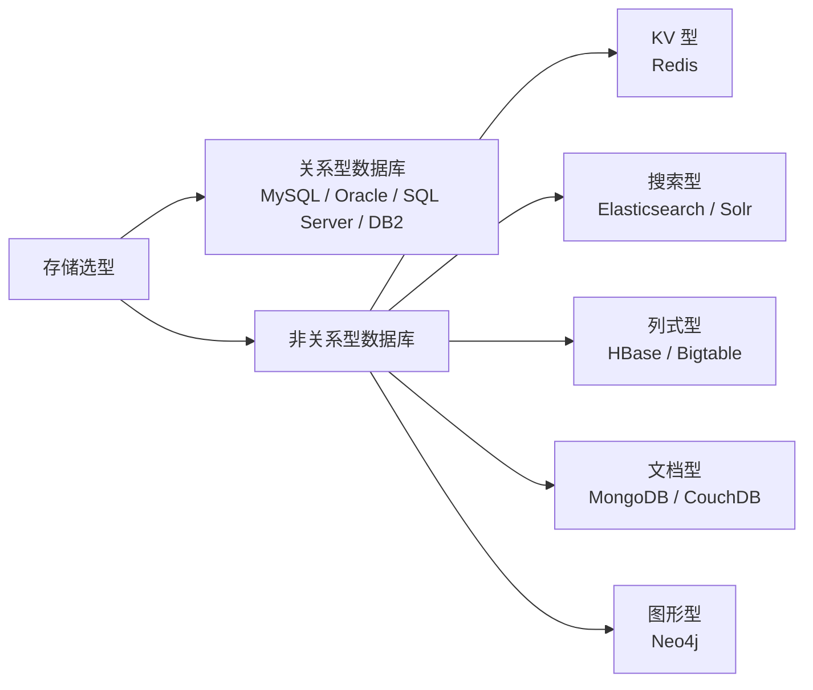

# 9. 六大数据库存储实战: 模块拆分与存储选型的技术架构设计

## 纲要

- 研发第一步永远是技术架构全局设计，而不是直接写代码
- 模块拆分：新零售核心业务、社交关系、社交内容三大板块
- 存储选型为何要单拎出来讨论
- 存储选型的两大大类：关系型数据库与非关系型数据库

## 📎 代码说明

本讲为**原理 / 架构**篇，正文以推演与图示为主，无配套代码片段；本章课件源码中亦无对应类文件。

## 先做全局设计，再动手编码

项目进入研发阶段的第一步，永远不是直接上手编写代码。缺乏全局视角会导致只看到某几个业务功能就动手，最终在模块划分与整体实现上出现**单点正确、全集缺失**的盲区。

技术架构的拆分分两步走：

1. **模块拆分**：大型项目中不同模块往往隶属于不同研发团队，必须按业务流程的定义，拆出合作清晰、边界明确的模块，支撑并行开发。
2. **存储选型**：在每个模块内，选择适合该业务场景的存储方案。

## 模块拆分

按照社交新零售的业务流程定义，系统被拆成三大板块，每个板块内含若干业务模块。

### 新零售核心业务模块

最底层，承载传统新零售电商服务的核心业务领域，与社交完全没有关系：

- **用户模块**：管理用户。
- **商品模块**：管理商品核心内容信息。
- **订单模块**：管理整个交易业务流程。

它提供用户、商品、订单三个最基础的服务能力，边界非常清晰。

### 社交关系模块

在核心业务模块之上引入社交属性，典型是**关注粉丝**业务模块，承载用户之间的关注、粉丝关系。

### 社交内容模块

基于核心业务与社交关系再迭代一层，包含：

- **Feed 模块**：处理整个社交内容发布的信息流。
- **点赞与评论模块**：承载用户在信息流中产生的社交行为与内容。

层次非常清晰：**底层是传统新零售核心业务能力，中间是社交关系模块，上方是社交内容体系**。

## 存储选型为什么必须单拎出来

对互联网这种集中式 Server 端应用场景而言，所有用户信息、交易数据、商品数据、关系数据、内容数据，都要通过中央服务器进行存储与转发。要构建高稳定、高性能的服务集群，**最重要的是把合适的存储用在合适的业务场景上**。

选型选错会付出持续代价：

- 业务层应用程序需要花很大力气去做数据一致性的异常处理。
- 这类异常处理往往吃力不讨好，而且**不一定能在应用层完全兜底**。
- 最终损失落到用户体验上。

| 维度 | 后果 |
| --- | --- |
| 研发成本 | 应用层需要大量补偿、对账、重试逻辑 |
| 稳定性 | 一致性问题难以在应用层完全收敛 |
| 体验 | 数据错乱、查询超时直接被用户感知 |

所以存储选型不是"选个数据库"这么简单，而是架构设计中不可绕过的一步。

## 存储选型的大分类

在匹配具体业务场景之前，先看清整个存储选型的地图：大类上分为**关系型数据库**与**非关系型数据库**。

非关系型的分类比关系型复杂得多，根本原因在于一条朴素的事实：**没有任何一种存储选型能满足所有场景，任何选型都是用来解决某一类特定场景下的部分问题，对该场景下的其他问题可能无能为力**。

这也是技术设计中反复强调的一点：不存在一套通用的解决方案，更多的是做存储选型与方案上的取舍。

## 小结

模块拆分给出了"做什么"，存储选型给出了"用什么装"。核心业务的高一致诉求、社交关系的图结构诉求、内容的高写入诉求、Feed 流的时序诉求，天然指向不同的存储。把这两件事想清楚再动手，才能避免在应用层疲于奔命地补一致性漏洞。

